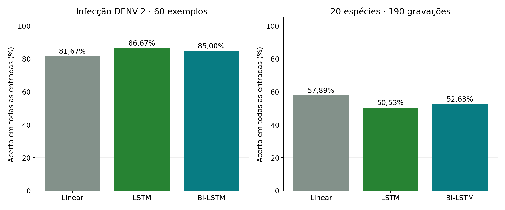
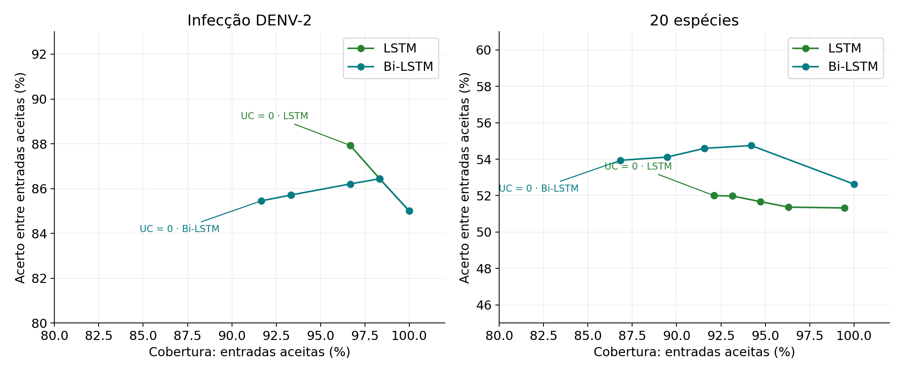
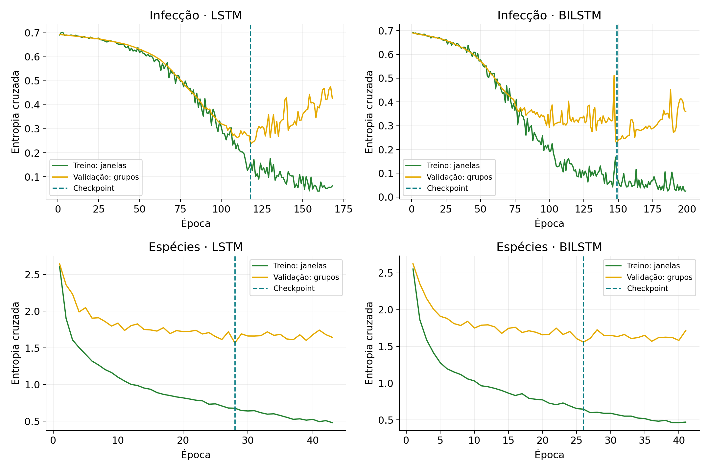
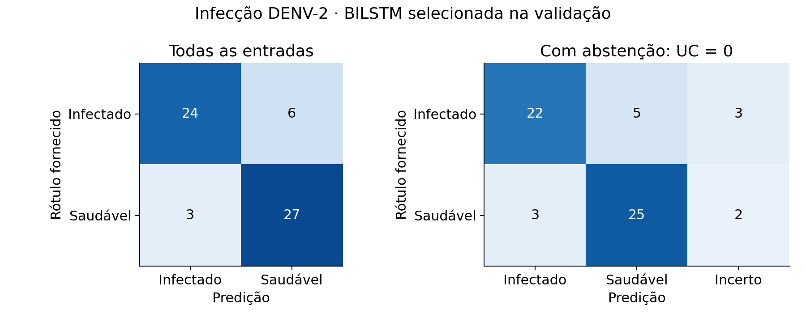

# Aplicação de Torres et al. (2025): LSTM, Bi-LSTM e Monte Carlo dropout

**Luiz Eduardo do Nascimento Ciarallo** · execução de 15/10/2026

Foram baixados os dados públicos e pesos dos autores, reexecutados os checkpoints e treinadas duas redes novas em cada base. As tarefas de infecção por DENV-2 e identificação de espécie usam o mesmo pipeline recorrente, com saídas e avaliações próprias.

## Resultados dos novos treinos

A tabela usa todas as entradas de teste, com predição determinística e sem descartar casos.

| Tarefa | Modelo | Acertos/total | Acerto | F1 macro |
|---|---|---:|---:|---:|
| Infecção DENV-2 | linear | 49/60 | 81,67% | 81,54% |
| Infecção DENV-2 | lstm | 52/60 | 86,67% | 86,61% |
| Infecção DENV-2 | bilstm | 51/60 | 85,00% | 84,96% |
| 20 espécies | linear | 110/190 | 57,89% | 62,48% |
| 20 espécies | lstm | 96/190 | 50,53% | 61,83% |
| 20 espécies | bilstm | 100/190 | 52,63% | 60,78% |

Seleção exclusivamente pela perda de validação: **infection: bilstm**; **species: bilstm**.
A escolha foi congelada antes da inferência de teste; o resultado de teste não troca o candidato escolhido.

Na tarefa de infecção, as duas redes superaram numericamente a referência linear nesta divisão. Na tarefa de 20 espécies, a referência linear obteve o maior acerto; esta rodada não sustenta substituir o classificador existente pelas redes recorrentes. A inferência com dropout e abstenção está disponível para comparação, com seus próprios denominadores.

## Monte Carlo dropout e abstenção

Cada entrada recebe 100 inferências com dropout entre as camadas recorrentes. A discordância é `UC = 1 - maior_contagem_de_votos / 100`. Para duas classes, isso equivale à fórmula de Torres et al. O limiar principal é UC = 0: todas as passagens devem votar na mesma classe.

| Tarefa | Modelo | Aceitas/total | Acertos nas aceitas | Acerto condicional | Cobertura | Acertos emitidos/total |
|---|---|---:|---:|---:|---:|---:|
| Infecção | lstm | 58/60 | 51 | 87,93% | 96,67% | 85,00% |
| Infecção | bilstm | 55/60 | 47 | 85,45% | 91,67% | 78,33% |
| Espécies | lstm | 175/190 | 91 | 52,00% | 92,11% | 47,89% |
| Espécies | bilstm | 165/190 | 89 | 53,94% | 86,84% | 46,84% |

O arquivo `selective_comparison.csv` preserva esses denominadores. Os arquivos individuais também mostram limiares predefinidos de 1%, 5%, 10%, 20% e 50% de discordância, sem escolha pelo teste.

## Dados e separação

| Base | Treino | Validação | Teste | Unidade de avaliação |
|---|---:|---:|---:|---|
| infection | 192 | 48 | 60 | Tensor fornecido pelos autores |
| species | 209 | 59 | 190 | Gravação original |

- A base dos autores contém **300 tensores, 150 por classe**, cada um com **188 passos e 32 bandas mel**. A ordem dos rótulos vem do código dos autores: 0 = infectado DENV-2, 1 = saudável.
- A base de espécies usa Dryad e preserva as 190 gravações do teste histórico. A auditoria removeu **36 grupos e 1115 janelas** das partições de menor prioridade quando o mesmo componente PCM aparecia em outra partição. O teste reúne **174 blocos PCM em 190 gravações**.
- Os rótulos de espécie não são convertidos em rótulos de infecção. MosquitoSong permanece fora desse treino.
- A referência linear foi ajustada de novo nas mesmas linhas retidas, com média e desvio temporal dos mesmos atributos mel.

## Técnicas implementadas

| Componente | Base dos autores | Adaptação ao projeto |
|---|---|---|
| Entrada | Mel fornecido: 188 × 32 | Mel calculado: 59 × 32 |
| Áudio / STFT | Artigo: 48 kHz; FFT/Hann 1.024; passo 256 | 16 kHz; FFT/Hann 1.024; passo 256; 80–4.000 Hz |
| Sequência | Cerca de 1 segundo por sinal | 0,992 segundo por janela |
| Rede | LSTM e Bi-LSTM, duas camadas, 256 unidades | Mesma estrutura, saída de 20 classes |
| Dropout | 0,20 entre camadas | 0,20 entre camadas |
| Otimizador | Adam, lr 0,000005; lote 16 | Adam, lr 0,0003; lote 128; clipping 3 |
| Épocas máximas | 300, paciência 50 | 80, paciência 15 |
| Escala ajustada no treino | Tensores originais, sem scaler adicional | Média/desvio por banda ajustados só no treino |
| Inferência | 100 passagens estocásticas | 100 passagens, agregação por gravação em cada passagem |

Foi usada `CrossEntropyLoss`, como no código público; a tabela do artigo descreve entropia cruzada binária. O treino usa amostragem com reposição balanceada por classe e gravação, para que uma gravação longa não domine uma classe. O readout segue o código dos autores: camada linear sobre a última saída da sequência. As camadas LSTM foram empilhadas com dropout explícito para contornar a dependência ausente do dropout recorrente do MIOpen. A equivalência determinística com o `nn.LSTM` original é testada nos dois sentidos.

## Reexecução dos pesos publicados

Fonte: [repositório dos autores](https://github.com/NakanoMariko/Dengue-Infected-Mosquito-Detection), commit `6c96ccd5347cf5bafc9b424579700af7b5ffb7ce`. O código público usa 260/40 e seleciona checkpoint pela perda nesses 40 exemplos; o texto do artigo informa 80/20. Esta reexecução usa os mesmos 40 exemplos do código, identificados separadamente dos novos treinos.

| Pesos dos autores | Acerto em todos os 40 | Acertos/aceitas com UC = 0 | Acerto condicional | Cobertura |
|---|---:|---:|---:|---:|
| lstm | 37/40 (92,50%) | 32/35 | 91,43% | 87,50% |
| bilstm | 38/40 (95,00%) | 36/38 | 94,74% | 95,00% |

O artigo informa 100 passagens; o script de teste publicado executa 10. Esta rodada fixa 100 passagens e semente 20261015. Os novos treinos usam validação separada, em vez de escolher checkpoint pela perda do teste.

## Gráficos









## Executar e conferir

```bash
.venv/bin/python fetch_torres_2025.py
.venv/bin/python apply_torres_2025.py --task all --output results/nova_rodada_torres
.venv/bin/python verify_torres_2025.py results/nova_rodada_torres
.venv/bin/python -m pytest -q
```

O executor recusa sobrescrever resultados existentes. `freeze.json` registra a escolha e os hashes antes do teste; `source/` preserva os scripts efetivamente executados. As previsões CSV e as 100 distribuições por grupo em NPZ permitem recalcular votação e abstenção. `artifact_format_migration.json` registra a conversão dos IDs dos NPZ para strings Unicode, sem alterar probabilidades, alvos ou pesos.

Para usar os pesos novos:

```bash
.venv/bin/python predict_torres_2025.py results/torres_2025_2026_10_15/species --audio caminho/arquivo.wav
.venv/bin/python predict_torres_2025.py results/torres_2025_2026_10_15/infection --author-row 0
```

O modelo de infecção recebe os tensores mel originais (`--author-row` ou `--features`); o repositório dos autores fornece só dois WAVs exemplificativos, e não os 300 sinais brutos com a receita completa de extração. O modelo de espécies tem frontend de áudio implementado e scaler congelado.

Validação: **298 testes aprovados no total, incluindo 13 novos**. `pytest.ini` restringe a coleta à pasta `tests/`, evitando importar scripts executáveis de pesquisa e cópias de entregas. `verification.json` confirma isolamento, hashes, seleção na validação, probabilidades e denominadores de abstenção.

## Referências

- Torres et al. (2025). *Dengue-Infected Mosquito Detection with Uncertainty Evaluation based on Monte Carlo Dropout*. IEEE Latin America Transactions 23(2), 135–143. https://latamt.ieeer9.org/index.php/transactions/article/view/9221
- Código e dados dos autores: https://github.com/NakanoMariko/Dengue-Infected-Mosquito-Detection/tree/6c96ccd5347cf5bafc9b424579700af7b5ffb7ce
- Gal e Ghahramani (2016). *Dropout as a Bayesian Approximation*. https://proceedings.mlr.press/v48/gal16.html

## Limitações e interpretação final

- Os 300 tensores dos autores não incluem identificadores de indivíduo ou gravação. A divisão protege hashes exatos, mas não comprova independência por mosquito. Os 40 exemplos da reexecução foram usados pelos autores na seleção dos pesos.
- O teste de espécies é retrospectivo e contém gravações relacionadas dentro do próprio teste. Os resultados não demonstram generalização para nova coleta em campo.
- Concordância em 100 passagens mede estabilidade do modelo com dropout; não confirma infecção nem garante correção. Acurácia entre aceitas deve ser lida junto com cobertura e erros emitidos.
- A tarefa de 20 espécies escolhe uma espécie de mosquito. Ela não mede a taxa operacional de falso alarme em ruído; a detecção ternária existente constitui outra avaliação.
- Um resultado maior em um conjunto não implica superioridade em outra tarefa. As tabelas mantêm os dois modelos, a seleção de validação e a referência linear para que esse julgamento seja verificável.
