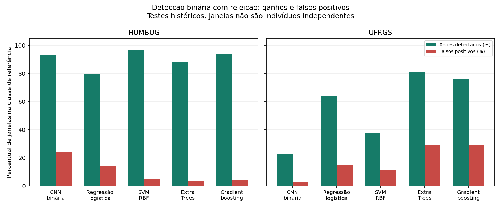

# Comparação de outras técnicas de ML: Aedes aegypti

**Quatro famílias de modelos clássicos foram treinadas e comparadas à CNN binária congelada.** Há ganhos importantes em algumas fontes, mas nenhuma versão demonstrou confiabilidade suficiente para liberar o aparelho. Não houve adaptação ou compilação para Arduino.

## Métodos e controle do experimento

Regressão logística (C 0,1/1), SVM com kernel RBF (C 1/10), Extra Trees (300 árvores, folhas mínimas 2/8) e gradient boosting histográfico (200 iterações, 15/31 folhas). Todas usam as mesmas 17.391 janelas válidas de treino e as mesmas partições de validação e calibração do detector binário; UFRGS inteira e áudio privado ficam fora do treino. Não houve novo treino de CNN. Dados e testes históricos já influenciaram decisões de projeto: esta comparação é exploratória, não avaliação final cega.

Extraímos **122 características acústicas**: média e variabilidade de energia relativa em 31 bandas de 125 Hz, coeficientes cepstrais por DCT dessas bandas lineares (não MFCC), centroide e largura espectral, rolloff, planicidade, entropia, picos de frequência, relações de harmônicos e fluxo espectral. FFT 2.048, hop 256, 16 kHz; remoção da média e normalização RMS por janela, sem preenchimento ou repetição. Janelas reais de 0,3 e 0,992 s são mantidas. Essas características não contêm nomes de arquivos, espécie, aparelho ou duração; mesmo assim podem reter assinaturas do ambiente.

Amostragem/ponderação: classes binárias com igual massa; negativos equilibrados entre rótulos, origens e grupos. Mosquitos de espécie não resolvida não recebem rótulo negativo. StandardScaler ajustado somente no treino. Dois candidatos por família, escolha pela AUC ponderada da validação. Calibração logística em grupos separados e limiar visando no máximo 5% de falsos positivos **ponderados** na calibração, não uma promessa de 5% em outras fontes. Há faixa de rejeição e guarda de qualidade.

O gradient boosting foi selecionado pela validação (AUC ponderada 0,9182), antes de consultar a nova seleção externa. Essa escolha foi preservada apesar dos resultados posteriores. Ao otimizar a explicabilidade, o processo foi retomado a partir dos arquivos já congelados de regressão logística e SVM, sem retreiná-los nem alterar parâmetros/limiares.

## Comparação histórica, com rejeição

Detecção de Aedes = emissões corretas / todas as janelas positivas. Falso positivo = emissões de Aedes / todas as janelas negativas rotuladas. Precisão = emissões corretas de Aedes / todas as emissões de Aedes com referência binária conhecida. Cobertura inclui emissões positivas e negativas, excluindo as rejeições. Não confundir com acurácia global. Janelas correlacionadas não são mosquitos independentes.

| Modelo | Fonte | Detecção de Aedes | Falsos positivos | Precisão de Aedes emitido | Cobertura conhecida |
|---|---|---:|---:|---:|---:|
| CNN binária | dryad | 84.4% | 1.2% | 77.2% | 99.1% |
| CNN binária | humbug | 93.5% | 24.4% | 34.0% | 92.0% |
| CNN binária | mosquitosong | 52.0% | Não avaliável | 100.0% | 97.4% |
| CNN binária | ufrgs | 22.5% | 2.7% | 93.8% | 89.0% |
| Regressão logística | dryad | 29.2% | 4.7% | 22.8% | 78.9% |
| Regressão logística | humbug | 79.9% | 14.5% | 42.6% | 69.8% |
| Regressão logística | mosquitosong | 58.2% | Não avaliável | 100.0% | 64.5% |
| Regressão logística | ufrgs | 63.8% | 15.1% | 88.7% | 67.9% |
| SVM RBF | dryad | 81.1% | 3.6% | 52.1% | 91.5% |
| SVM RBF | humbug | 96.8% | 5.2% | 71.6% | 78.4% |
| SVM RBF | mosquitosong | 57.7% | Não avaliável | 100.0% | 79.8% |
| SVM RBF | ufrgs | 38.0% | 11.6% | 85.8% | 65.5% |
| Extra Trees | dryad | 75.0% | 5.0% | 41.9% | 92.9% |
| Extra Trees | humbug | 88.3% | 3.4% | 77.7% | 90.2% |
| Extra Trees | mosquitosong | 57.4% | Não avaliável | 100.0% | 83.2% |
| Extra Trees | ufrgs | 81.2% | 29.5% | 83.7% | 74.3% |
| Gradient boosting | dryad | 79.4% | 4.7% | 44.5% | 91.5% |
| Gradient boosting | humbug | 94.2% | 4.3% | 74.7% | 83.2% |
| Gradient boosting | mosquitosong | 58.5% | Não avaliável | 100.0% | 77.0% |
| Gradient boosting | ufrgs | 76.0% | 29.5% | 82.7% | 73.1% |

Dryad: 360 janelas positivas e 7.541 negativas; HumBug: 154 positivas, 1.144 negativas e 212 de espécie não resolvida; UFRGS: 271 positivas e 146 negativas; desafio MosquitoSong: 352 positivas, sem negativos. A ausência de negativos em MosquitoSong não permite medir falsos positivos nem sustenta uma precisão de 100% em uso real. Os grupos UFRGS são categorias de sexo/pasta, não indivíduos identificados.

O SVM melhora o compromisso do HumBug: 149/154 Aedes aceitos corretamente, 59/1.144 falsos positivos, frente a 144/154 e 279/1.144 na CNN. Na UFRGS, Extra Trees aceita 220/271 Aedes, mas erra 43/146 negativos; a CNN aceita 61/271 com quatro falsos positivos. Maior sensibilidade não significa melhor confiabilidade universal. Percentuais dependem da prevalência de Aedes no conjunto e dos limiares; não compará-los como se fossem um único número de acurácia do aparelho.



## Novo teste após congelar todos os modelos

Busca online, seleção de metadados e download de cinco gravações HumBug posteriores ao congelamento de todos os modelos. Excluídos grupos de treinamento/avaliação e todos os WAV numéricos HumBug anteriormente baixados. Selecionadas as duas únicas origens positivas restantes com duração >=0,3 s e três negativas de espécies distintas, por ordem de metadados, antes de inferir. Áudios: Aedes 53 e 220411, outros IDs na seleção JSON. Verificados CRC e SHA-256; sem bytes iguais aos arquivos externos locais. Não concluída auditoria de sobreposição deslocada nem identidade individual entre fontes. Campanhas familiares, não domínio totalmente novo. O conjunto negativo inclui Ae. albopictus (ID 87), An. arabiensis (206567) e An. dirus (245).

O teste contém **somente oito janelas: três positivas e cinco negativas**. É insuficiente para afirmar desempenho estável.

| Modelo | Aedes aceitos corretamente / 3 | Falsos positivos / 5 | Rejeições |
|---|---:|---:|---:|
| CNN binária | 1/3 | 0/5 | 0 |
| Extra Trees | 2/3 | 2/5 | 0 |
| Gradient boosting | 2/3 | 2/5 | 0 |
| Regressão logística | 0/3 | 1/5 | 2 |
| SVM RBF | 3/3 | 1/5 | 2 |

SVM detectou as três janelas positivas, mas gerou um falso positivo; o resultado favorável em uma amostra tão pequena não autoriza mudar o vencedor pela validação nem liberar firmware. Os demais modelos também apresentaram erros.

## Seu áudio privado de enxame

107 janelas, com a espécie informada pelo usuário, sem confirmação independente ou anotação da presença do mosquito por instante. Não foi usado no treino ou ajuste de limiares. Somente resultados agregados são públicos; WAV e previsões por instante continuam locais e ignorados pelo Git.

| Modelo | Indicações de Aedes | Não-Aedes | Incerto | Inválido |
|---|---:|---:|---:|---:|
| Regressão logística | 15 | 54 | 36 | 2 |
| SVM RBF | 25 | 41 | 39 | 2 |
| Extra Trees | 66 | 26 | 13 | 2 |
| Gradient boosting | 55 | 23 | 27 | 2 |
| CNN binária | 20 | 72 | 13 | 2 |

Mais indicações de Aedes nesse arquivo não demonstram melhor acerto: os modelos com mais indicações também geram falsos positivos relevantes nos controles. Não declarar as janelas negativas como erros confirmados, pois não há anotação por instante.

## Explicabilidade

Importância por permutação calculada exclusivamente em uma seleção de 256 janelas de validação (128 de cada classe), com os mesmos exemplos e pesos para a AUC inicial e todas as permutações, três repetições. Arquivos explanation_*.csv mostram a queda de AUC ao embaralhar cada característica. Coeficientes da regressão logística são exportados em unidades padronizadas. As bandas e coeficientes são correlacionados: importância não comprova causalidade, um marcador biológico exclusivo ou estabilidade fora dessas fontes. Nenhum resultado explicativo foi usado para ajustar modelos ou consultar o teste final.

## Uso e decisão

```bash
.venv/bin/python aedes_classical.py gravacao.wav --model svm_rbf --output tmp/teste_svm
```

Opções: logistic, svm_rbf, extra_trees e gradient_boosting. Sem --model, usa o gradient boosting selecionado pela validação. Precisa dos arquivos locais results/aedes_classical/models/*.joblib, ignorados pelo Git. Não substitui automaticamente o algoritmo anterior nem publica novos pesos. Salva predictions.csv e summary.json; aceita pelo menos 0,3 s de som real.

**Manter todos em avaliação offline.** O foco binário e as características acústicas trouxeram ganhos parciais, mas há troca entre falsos positivos e perdas de Aedes. Próximo experimento deve incluir negativos acusticamente semelhantes e dados da caixa/microfone real, com indivíduos e dias novos reservados para teste. Novas decisões orientadas pelos testes desta rodada tornam esses áudios históricos; outro treinamento exige buscar outro áudio inédito após congelar.

Fontes primárias: [SVM](https://scikit-learn.org/stable/modules/svm.html), [árvores e boosting](https://scikit-learn.org/stable/modules/ensemble.html), [HumBugDB](https://zenodo.org/records/4904800). Resultados locais: results/aedes_classical/comparison.csv, training_audit.json, evaluation_audit.json e fresh_external/selection.json. Notebook: seção 26.

### Características mais influentes no SVM, na validação

| Característica embaralhada | Queda média de AUC |
|---|---:|
| band_1000_1125_mean | 0.0537 |
| band_375_500_mean | 0.0410 |
| band_1250_1375_mean | 0.0359 |
| cepstrum_10_mean | 0.0256 |
| cepstrum_11_mean | 0.0224 |

As bandas de 1.000–1.125, 375–500 e 1.250–1.375 Hz aparecem entre as mais influentes; isso descreve o comportamento do classificador nessa validação, não uma assinatura exclusiva da espécie.
