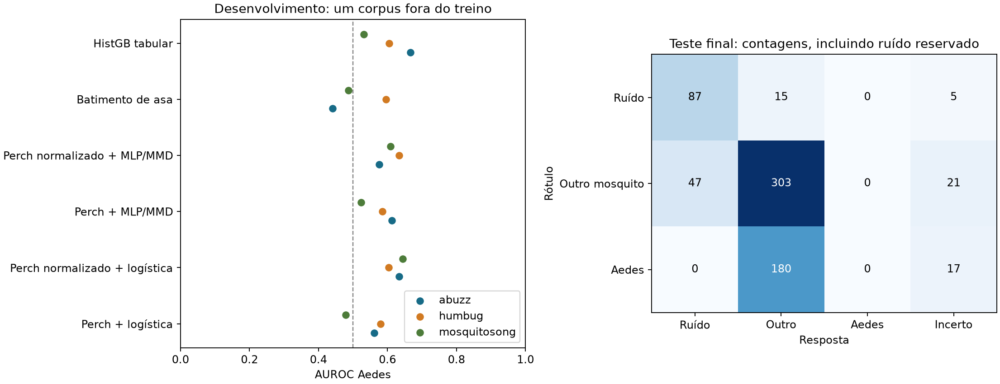

# Continuação da v3: resultados e limites

Experimento concluído em 20/10/2026. Os arquivos brutos, caches e pesos ficam locais; saídas leves auditáveis estão em `reanalysis/outputs/v3_continuation/`.

## Resultado principal
Candidato congelado pelo desenvolvimento: **Perch normalizado + logística** (`A_perch_white`). Elegível pelos critérios de desenvolvimento: **não**.
Nenhum candidato atingiu as metas no desenvolvimento; este foi congelado apenas para uma avaliação descritiva, pelo maior AUROC médio.

| Avaliação final | Contagem | Taxa e IC95% por cluster |
|---|---:|---|
| Aedes detectados | 0/197 | 0.00% (bootstrap degenerado) |
| Alertas corretos entre alertas Aedes | 0/0 | indefinido |
| Outros mosquitos chamados Aedes | 0/371 | 0.00% (bootstrap degenerado) |
| Ruídos chamados Aedes | 0/107 | 0.00% (bootstrap degenerado) |
| Cobertura nos mosquitos (resposta diferente de incerto) | 530/568 | 93.31% [90.89–97.26] |

AUROC Aedes no teste reservado: 0.729. Metas pontuais atingidas: **não**. Apoio estatístico conforme a regra congelada: **não**. **Não há validação de campo.**



**Leitura operacional.** Zero falsos alertas veio acompanhado de zero Aedes detectados. Isso não constitui um detector útil nem comprova um limite populacional de falsos positivos. Em particular, 0/107 ruídos tem limite superior binomial descritivo de 3.39% (IC95%), já acima da meta de 1%, mesmo antes de considerar dependência entre arquivos. Os intervalos bootstrap degenerados não resolvem essa limitação.

Na ablação predefinida **sem o portão de concordância**, a mesma cabeça detectou **17/197 Aedes (8.63%)**, com **20/371 falsos alertas entre outros mosquitos (5.39%)** e precisão de **45.95%**. O portão prejudicou a sensibilidade; removê-lo também não atinge as metas. Esse resultado não foi usado para mudar a configuração final.

## Onde o trabalho foi retomado
O Claude havia baixado e conferido o HumBugDB completo, calculado componentes de duplicação e preparado o manifesto v3, mas não havia salvo características nem treinado classificadores v3. A análise inicial e as decisões antes de qualquer novo resultado estão em `analise_de_lacunas_continuacao_v3.md`, `protocol_v3_continuation.json` e no congelamento correspondente.

Dois clusters provisórios cruzavam treino e teste. Foram colocados em quarentena 286 arquivos de desenvolvimento relacionados a eles. O teste de mosquitos herdado foi mantido. Reservaram-se adicionalmente 107 arquivos de 67 clusters exclusivamente de ruído, com seed fixa, antes de qualquer treino. Caminhos, componentes e clusters estão separados entre desenvolvimento e avaliações finais.

## Métodos e escolhas
O Perch 2.0 permanece congelado. Comparam-se áudio sem/com normalização espectral por gravação, cabeças logísticas, MLP de 256 unidades com MMD, descritores do batimento e HistGB tabular. Cada arquivo recebe uma unidade de massa; a representação é a média das características de suas janelas. São no máximo seis janelas Perch de cinco segundos e 30 janelas acústicas de um segundo. Arquivos curtos recebem zeros, sem repetição de áudio.

Em cada avaliação, clusters de ajuste e calibração ficam separados. A escolha de parâmetros usa três dobras internas apenas no ajuste. As duas etapas são presença de mosquito e Aedes entre mosquitos. Calibradores e limiares usam a calibração; não há refit sobre ela antes do teste. Discordância com a cabeça de batimento gera `incerto`; esses casos continuam nos denominadores. A análise sem esse portão é publicada separadamente.

A seleção final usa o desempenho LODO em Abuzz, HumBug e MosquitoSong, com sensibilidade mínima de 20% e limites de FPR de 2% em outros mosquitos e 1% em ruído. Os limites são exigidos em cada corpus onde são mensuráveis. Se nenhum candidato se qualifica, o maior AUROC médio é congelado apenas para uma avaliação descritiva. O teste final não escolhe modelo, parâmetros ou limiar.

## Desenvolvimento: cada corpus fora do treino
| Candidato | Abuzz: recall / FPR outros | HumBug: recall / FPR outros | MosquitoSong: recall / FPR outros |
|---|---|---|---|
| Perch + logística | 0.00% / 0.00% | 0.00% / 0.00% | 0.28% / 1.88% |
| Perch normalizado + logística | 0.00% / 0.00% | 0.00% / 0.00% | 0.28% / 0.52% |
| Perch + MLP/MMD | 0.00% / 0.00% | 0.00% / 0.00% | 0.83% / 3.23% |
| Perch normalizado + MLP/MMD | 0.00% / 0.00% | 0.00% / 0.05% | 0.28% / 0.94% |
| Batimento de asa | 0.00% / 0.00% | 0.00% / 1.38% | 7.18% / 6.26% |
| HistGB tabular | 0.00% / 0.00% | 0.00% / 0.00% | 0.28% / 0.00% |

Todas as métricas, os intervalos e o diagnóstico que usa somente duração estão nos JSONs/CSVs publicados. Precisão indefinida por ausência de alertas não é tratada como 100%. A seleção usa precisão zero nesse caso.

## Calibração com poucos exemplos
Após congelar a configuração, foram executados os braços predefinidos com 5, 10 e 20 arquivos por classe, cinco seeds, ajustando somente as cabeças leves. Todo arquivo de qualquer cluster usado na calibração é retirado da avaliação, inclusive arquivos desse cluster não escolhidos para calibração. Mantêm-se os calibradores e limiares de origem. Braços sem arquivos/clusters suficientes são explicitamente indisponíveis.

Braços executados: 46/60. Resultados individuais em `fewshot_summary.csv`; não somar os denominadores das repetições como se fossem novos mosquitos independentes.

| Corpus de adaptação | Braços disponíveis | Sensibilidade: mínimo–máximo entre repetições |
|---|---:|---|
| abuzz | 8/15 | 0.00%–0.00% |
| humbug | 15/15 | 0.00%–0.00% |
| mosquitosong | 15/15 | 1.11%–10.22% |
| final_locked | 8/15 | 0.00%–0.00% |

No teste reservado, nenhum dos oito braços disponíveis detectou Aedes. As variações entre repetições não são campanhas independentes. Mantiveram-se limiares e calibradores de origem; isso limita a conclusão sobre outras formas de calibração local.

## Limites da evidência
- O teste de mosquitos tem 568 arquivos e 8 clusters, com apenas 3 clusters contendo Aedes. Não são 568 indivíduos independentes.
- O conjunto é relacionado ao domínio D3 do BioDCASE e aos áudios UFRGS conhecidos; a proveniência UFRGS não foi confirmada para todos os clipes. Metadados de origem e contagens aparecem separados.
- 15 componentes do teste já tinham predições em experimentos anteriores. Os 553 restantes não tinham sido pontuados, mas o desenho da pesquisa é retrospectivo/adaptativo; não corresponde a uma nova coleta cega.
- O teste complementar de ruído vem das origens de desenvolvimento e não mede falsos alarmes em um ambiente de campo novo. Sua precisão estatística é limitada.
- Bootstrap de clusters não mede a variabilidade de retreinar modelos. Com zero erros ele pode gerar intervalo degenerado; isso não estabelece um limite populacional para erros raros. Intervalos binomiais por arquivo são publicados apenas como descrição e não corrigem dependência entre arquivos.
- Duração, zero-padding e composição de espécies continuam podendo revelar a origem. A ablação de normalização e o diagnóstico de duração investigam esse risco, sem demonstrar sua eliminação.
- Os números antigos permanecem resultados do corpus e protocolo anteriores. Mudaram dados, representação e modelos; não atribuir diferenças apenas à correção da divisão nem dizer que toda decisão anterior reconhecia exclusivamente a fonte.

## Reprodução e inferência
```bash
python -m pip install -r requirements.txt -r reanalysis/requirements-v3.txt
python -m reanalysis.v3_continue_manifest
python -m reanalysis.v3_features
python -m reanalysis.v3_train dev
python -m reanalysis.v3_train final
python -m reanalysis.v3_train fewshot
python -m reanalysis.v3_report
python -m pytest -q
```
Os áudios e os componentes herdados devem existir antes da primeira etapa. Não há aquisição automática de dados privados. `final` recusa mudança de configuração e reutiliza a avaliação registrada em vez de selecionar novamente pelo teste. A extração é retomável somente com a mesma identidade de dados/código/modelo.

Modelo local: `results/v3_continuation/final/A_perch_white.joblib`, SHA-256 `37e93a87209b80f56947d2cc266445d5dc42c270199d68ebc6be6d3a39f19ea6`. Inferência de pesquisa: `python -m reanalysis.v3_predict --audio caminho.wav`. O portão de batimento é carregado junto e a saída informa que o modelo não foi validado em campo.

Referências de método: [Perch, código oficial](https://github.com/google-research/perch), [Gong et al., preprint de alinhamento de domínios](https://arxiv.org/abs/2610.09737), [BioDCASE, tarefa oficial](https://biodcase.github.io/challenge2026/task5). Esta implementação é uma adaptação registrada, não uma reprodução integral desses trabalhos.

## Correção técnica e verificações finais

A emenda A3 recuperou as durações físicas de 67 arquivos MP4/M4A dos metadados v2 congelados, apenas para o diagnóstico de duração. Não houve imputação por rótulo, troca de partições, alteração de hiperparâmetros ou dos seis candidatos acústicos já executados. O código anterior, as identidades e os hashes dos modelos foram preservados; a auditoria está em `technical_amendment_A3.json`.

A suíte terminou com **70 testes aprovados**. A inferência em um WAV real de desenvolvimento foi comparada às características em cache e produziu o mesmo rótulo e escore dentro da tolerância numérica. Os hashes do notebook, dos metadados de referência e dos pesos históricos permaneceram idênticos.
