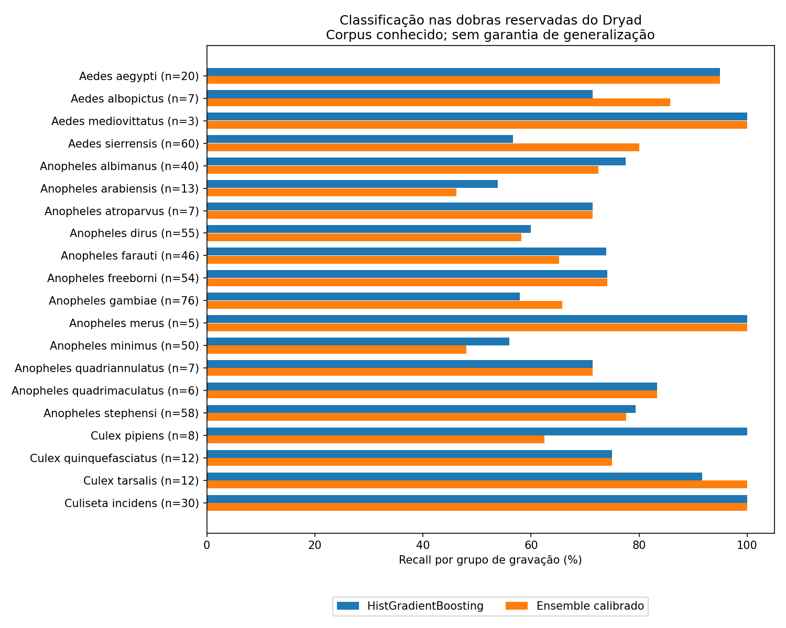

# Ensemble por espécie com calibração separada — 09/10/2026

**Treinamento novo de três modelos, com teste separado do ajuste e da calibração. Continua experimental, sem comprovação de confiabilidade em novas aquisições.** Esta rodada corrige o caminho de dependência encontrado na calibração anterior. Não repete integralmente o ensemble antigo de sete modelos.

## Protocolo executado

SVM RBF, ExtraTrees e HistGradientBoosting usam as mesmas partições de gravação. Mantidas as três dobras externas históricas; dentro do treino externo, reservados 20% dos grupos de cada espécie para calibração, com ao menos um grupo. Os modelos-base, incluindo o scaler SVM, veem apenas o ajuste. Os pesos e correções de classe são ajustados na calibração; o teste externo à calibração é consultado somente na avaliação. Não há refit dos modelos na calibração antes do teste.

Comparamos cada base, uma média fixa e a mistura calibrada nos mesmos arquivos. Primário declarado antes de testar: `calibrated`. São 23.877 janelas e 569 grupos das 20 espécies Dryad. Os arquivos já orientaram pesquisas anteriores; o resultado interno é retrospectivo. Grupos não comprovam independência de indivíduos/sessões. A gravação recebe a média de suas janelas reais.

Para rejeição por gravação, cada modelo tem limiar escolhido somente na calibração: alvo de 90% de acerto nas emissões, com ao menos 20 grupos emitidos. Esse alvo pode falhar no teste. Se a calibração não satisfaz o critério, o modelo se abstém de todas as gravações. É rejeição por confiança de espécie; não há detector de presença ou validação de falsos alarmes em ruído neste experimento. O frontend de frequências/contraste é fixo; nenhuma normalização do lote de teste é aprendida.

## Teste por espécie no corpus conhecido

| Modelo | Acerto por janela, forçado | Acerto por gravação, forçado | Recall médio das 20 espécies | Cobertura com rejeição | Acerto entre emissões |
|---|---:|---:|---:|---:|---:|
| svm | 45.49% | 64.32% | 75.19% | 41.5% | 74.6% |
| extra_trees | 46.01% | 58.17% | 61.99% | 10.7% | 91.8% |
| hist_gradient_boosting | 50.26% | 70.65% | 77.42% | 49.6% | 90.1% |
| fixed | 49.48% | 67.66% | 76.52% | 48.3% | 87.6% |
| calibrated | 50.26% | 71.70% | 76.60% | 61.7% | 88.9% |

Escolha forçada sempre retorna uma das 20 espécies; rejeição conserva todas as gravações no denominador de cobertura. Não comparar a última coluna isoladamente. O ganho de acerto ao rejeitar pode vir de emitir poucas identificações.

Comparação pareada por gravação, com 2.000 reamostragens estratificadas por espécie:

- Calibrado menos hist_gradient_boosting: +1.03 pontos percentuais; IC condicional de 95% -1.23 a +3.16.
- Calibrado menos fixed: +4.02 pontos percentuais; IC condicional de 95% +1.58 a +6.50.

Os intervalos são condicionais aos modelos já ajustados e aos grupos observados, sem reexecutar o treino. Não são garantia em outro microfone, ambiente, indivíduo ou campanha. A avaliação não mede eventos de voo independentes.

### Modelo primário, por gravação

| Espécie | Corretas / grupos | Recall | Precisão | F1 |
|---|---:|---:|---:|---:|
| Aedes aegypti | 19/20 | 95.0% | 86.4% | 90.5% |
| Aedes albopictus | 6/7 | 85.7% | 37.5% | 52.2% |
| Aedes mediovittatus | 3/3 | 100.0% | 100.0% | 100.0% |
| Aedes sierrensis | 48/60 | 80.0% | 96.0% | 87.3% |
| Anopheles albimanus | 29/40 | 72.5% | 74.4% | 73.4% |
| Anopheles arabiensis | 6/13 | 46.2% | 60.0% | 52.2% |
| Anopheles atroparvus | 5/7 | 71.4% | 71.4% | 71.4% |
| Anopheles dirus | 32/55 | 58.2% | 66.7% | 62.1% |
| Anopheles farauti | 30/46 | 65.2% | 66.7% | 65.9% |
| Anopheles freeborni | 40/54 | 74.1% | 75.5% | 74.8% |
| Anopheles gambiae | 50/76 | 65.8% | 68.5% | 67.1% |
| Anopheles merus | 5/5 | 100.0% | 62.5% | 76.9% |
| Anopheles minimus | 24/50 | 48.0% | 66.7% | 55.8% |
| Anopheles quadriannulatus | 5/7 | 71.4% | 55.6% | 62.5% |
| Anopheles quadrimaculatus | 5/6 | 83.3% | 83.3% | 83.3% |
| Anopheles stephensi | 45/58 | 77.6% | 59.2% | 67.2% |
| Culex pipiens | 5/8 | 62.5% | 62.5% | 62.5% |
| Culex quinquefasciatus | 9/12 | 75.0% | 56.2% | 64.3% |
| Culex tarsalis | 12/12 | 100.0% | 92.3% | 96.0% |
| Culiseta incidens | 30/30 | 100.0% | 96.8% | 98.4% |



## Teste depois do congelamento

No teste de arquivos externos selecionados depois do congelamento, o calibrado acertou **4/17 arquivos (23.5%)** sem rejeição. Em 187 janelas reais, acertou 6 quando forçado. Com o limiar congelado, emitiu **8 identificações: 2 corretas e 6 erradas**; cobertura 47.1% e acerto nas emissões 25.0%. Não atingiu o alvo de 90% aprendido na calibração.

| Espécie externa | Arquivos corretos / avaliados, escolha forçada |
|---|---:|
| Aedes aegypti | 0/4 |
| Aedes albopictus | 0/1 |
| Anopheles minimus | 1/4 |
| Anopheles stephensi | 3/4 |
| Culex pipiens | 0/4 |

Foram procurados quatro arquivos ainda não usados para cada uma das nove espécies acústicas D3 do [BioDCASE oficial](https://zenodo.org/records/19095788), em ordem de ID e com duração real de ao menos um segundo. Só cinco espécies tinham arquivos disponíveis após excluir nomes já presentes: quatro Ae. aegypti, um Ae. albopictus e quatro de cada Culex pipiens, Anopheles minimus e Anopheles stephensi. Não houve substituição por acerto do classificador. Os 17 arquivos passaram pela auditoria de bytes e fragmentos PCM declarados. A varredura incluiu 7.535 caminhos WAV; 261 não foram decodificados, sendo metadados AppleDouble e fixtures de teste SciPy, registrados na seleção. O teste de novidade não cobre cortes em deslocamentos arbitrários nem identidade biológica.

Esses arquivos pertencem a um corpus conhecido, com ancestralidade de indivíduos/sessões incompleta; não são uma coleta independente nova. Os IDs sequenciais podem ser recortes relacionados: **17 arquivos não equivalem a 17 mosquitos**. Os longos arquivos Aedes dominam a contagem de janelas, por isso a acurácia por janela externa não deve ser comparada à distribuição Dryad sem considerar espécies/durações. Consulte [métricas externas](../results/species_nested_2026_10_09/external_metrics.csv), [seleção](../results/species_nested_2026_10_09/fresh_selection.json) e [auditoria de novidade](../results/species_nested_2026_10_09/novelty_audit.csv).

No áudio conhecido informado pelo usuário como Aedes aegypti, o calibrado acertou 5/106 janelas quando forçado; a espécie agregada foi `Anopheles gambiae` e a emissão com o limiar congelado foi `UNCERTAIN`. A referência é a informação do usuário sobre todo o áudio; não há anotação independente de cada voo. Esse é um controle retrospectivo, não um teste novo.

## Evidência e reprodução

[Partições por linha, grupo, caminho e hash](../results/species_nested_2026_10_09/partitions.csv) · [Auditoria de disjunção](../results/species_nested_2026_10_09/partition_audit.json) · [Protocolo](../results/species_nested_2026_10_09/protocol.json) · [Congelamento](../results/species_nested_2026_10_09/freeze.json) · [Intervalos](../results/species_nested_2026_10_09/intervals.json) · [Métricas por espécie](../results/species_nested_2026_10_09/per_species.csv).

Nenhum peso anterior, firmware ou instalador foi substituído. Modelos locais ignorados pelo Git. Para repetir o treino, usar outra pasta de saída; o script recusa sobrescrever uma pasta com protocolo existente.

```bash
OMP_NUM_THREADS=4 OPENBLAS_NUM_THREADS=4 .venv/bin/python nested_species_ensemble.py --output results/outra_rodada
.venv/bin/python summarize_nested_species.py
.venv/bin/python -m pytest -q tests
```

Os resultados de `results/species_nested_2026_10_09/` usam o código identificado pelos hashes do protocolo. `optimize_ensemble_oof.py` passou a encaminhar para o experimento corrigido; a implementação antiga está preservada no histórico Git em `1ab88b8`. A aquisição recusa selecionar novamente quando já há um manifesto, e a avaliação recusa sobrescrever as métricas externas. Para executar essas etapas em outro experimento, passar seu `--output` explicitamente para `evaluate_nested_species.py --phase acquire` e depois `--phase evaluate`. Os áudios já adquiridos não são novos para a próxima rodada.

Não chamar o resultado de redução quantificada do vazamento do ensemble antigo: o número de membros e a quantidade de dados de ajuste também mudaram. Para confirmar confiabilidade, ainda é necessária aquisição independente, com espécie de referência, negativos/ruído e diversidade de indivíduos, sessões e dispositivos. Foram aprovados **136 testes**, incluindo a disjunção das partições realmente executadas, scalers ajustados apenas no treino, identidade das linhas OOF e hashes dos modelos/limiares congelados.
