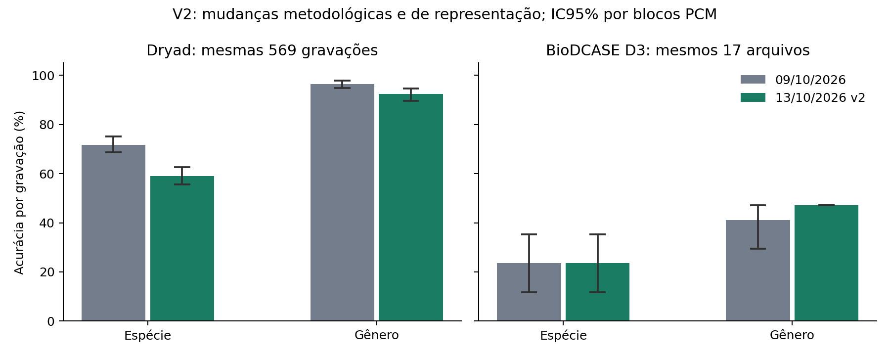

# Ensemble de espécies v2 — rodada local de 13/10/2026

## Conclusão e decisão

Treinamento e avaliação offline executados. A confiabilidade externa **não foi atingida**. No BioDCASE D3 pareado, a v2 acertou 4/17 espécies e 8/17 gêneros. Não houve promoção do modelo por resultados externos. Presença, gênero e espécie têm saídas separadas; o sistema integrado com gate de presença também está nos CSVs. Firmware, cabeçalhos de produção e instalador não foram alterados nem compilados.

O recálculo PCM encontrou **53 ligações adicionais** entre grupos declarados: 613 grupos originais, 560 blocos de colisão. Um bloco contém 54 grupos com fundo compartilhado e múltiplos rótulos fracos. Os rótulos e denominadores originais foram mantidos. As três dobras foram refeitas por blocos PCM. Na versão histórica, o número de blocos que atravessava partições em cada execução era {'0': 1, '1': 1, '2': 1, 'final': 1}. Logo, a diferença v1–v2 combina correção do isolamento, outras partições internas e novas representações; não é uma ablação causal das features.

## Inspeção da linha de base

Foram inspecionados os arquivos solicitados, loaders, manifestos e testes. A linha de base passou com **136 testes**. O gênero de 09/10 já era marginalizado em `evaluate_nested_genus.py`; a hipótese de que vinha apenas da espécie vencedora não se confirmou. Essa versão não tinha rejeição específica de gênero. O frontend `extract_robust_features` tem um parâmetro CMVN que não aplica a transformação anunciada; a v2 usa uma implementação própria explícita. O rastreador antigo retém um único pico; a v2 adiciona perfil harmônico multi-pico. Fontes comprimidas foram decodificadas pelo mesmo FFmpeg a 16 kHz do loader original, sem reescrever caches.

## Dados, isolamento e denominadores

São 24405 janelas reais de 1 s, 20 espécies, 569 grupos positivos e 44 grupos de ruído originalmente declarados, correspondentes a 818 caminhos. Usa-se a ordem do `results/segments.csv` e `data/cache/waves.npy`; SHA-256 de ambos e da configuração original estão no protocolo. O cache contém janelas já centralizadas e normalizadas individualmente por RMS, nunca por lote.

O grafo PCM verifica decodificação inteira e fragmentos alinhados de 1, .992 e .3 s a 8 kHz, com variantes de ganho, excluindo fragmentos quase constantes. Não prova ausência de derivados com deslocamentos arbitrários, identidade biológica, sessões ou ambientes compartilhados. Cada componente permanece integralmente em fit, calibração ou teste; os testes auditam linhas, caminhos, hashes, grupos originais e blocos. Blocos de rótulos mistos são separados por união gulosa com semente, conservando representantes de cada classe em fit e calibração. Não foram eliminados para melhorar métricas.

A unidade das métricas continua sendo o grupo original de gravação, para preservar o pareamento. A unidade independente dos intervalos é o bloco PCM. As espécies são classificadas em escolha fechada; ruído não recebe uma espécie verdadeira. Identificação e presença são avaliadas separadamente, e as colunas com gate mostram a emissão operacional combinada.

A qualidade antiga exige todas as janelas válidas para emitir por gravação. A regra v2 pré-declarada permite votar apenas com janelas válidas selecionadas pelo MIL; uma gravação sem voto válido é inválida e não emite. Janelas inválidas continuam nos diagnósticos por janela e o arquivo continua no denominador por gravação. Assim, mudanças de cobertura também incluem essa política de agregação/qualidade, não apenas a confiança do classificador.

## As cinco correções

1. **F1 auditado:** `macro_f1_support_only` usa as classes verdadeiras presentes; `macro_f1_strict_union` usa a união das classes verdadeiras e preditas. Predições em táxons ausentes também prejudicam o recall das classes verdadeiras na primeira métrica; a segunda adiciona explicitamente F1 zero para os táxons espúrios. O nome antigo `macro_f1` permanece compatível nos scripts históricos, sem regenerar resultados antigos. Os CSVs novos expõem ambas e a diferença.
2. **Gênero probabilístico:** soma exata das probabilidades calibradas de espécies de cada gênero, com limiar próprio escolhido exclusivamente na calibração. O gênero da espécie vencedora aparece como comparador forçado. O gênero histórico tem cobertura de escolha forçada; não se inventou um limiar histórico.
3. **Rótulos fracos/MIL:** saliência estima contraste dos harmônicos 1–4 de candidatos 200–900 Hz contra a mediana espectral local dentro da janela. Combina contraste e fração de energia em bandas de ±15 Hz; fica entre .1 e 3, sem apagar grupos. No fit multiplica o peso de cada janela. No MIL, escolhem-se top 25%, 50% ou 100% das janelas por saliência; o voto pesa saliência vezes max(1−H(p)/log K, .01). Empates são determinísticos. A fração é escolhida por acurácia balanceada, F1 estrito e maior fração como desempate, apenas na calibração.
4. **Canal/aparelho:** PSD centrado por mediana, remoção de inclinação em log-frequência e escala IQR intra-janela; MFCC médios 0–2 zerados e coeficiente 3 atenuado por .25, mantendo variabilidade e deltas. Contraste espectral local reduz envoltórias suaves. Isso não garante invariância a qualquer microfone. Pesos de treino combinam inverso do tamanho do bloco PCM, balanceamento de classe, raiz do inverso amortecido da frequência espécie/aparelho e saliência. Todas as frequências vêm exclusivamente do fit; aparelho desconhecido permanece uma categoria explícita.
5. **Multi-picos/enxame:** pente harmônico baseado em soma sub-harmônica, componente de presença de fundamental contra erros de oitava, três picos separados e seus contrastes/razões harmônicas; também entropia, espalhamento e evolução do perfil. Não é uma reprodução exata do algoritmo de Hermes e não resolve automaticamente misturas de espécies ou valida indivíduos em enxame.

## Estimadores e calibração

SVM RBF C=3 com StandardScaler ajustado só no fit; ExtraTrees com 200 árvores, max_features=.5 e min_samples_leaf=2; HistGradientBoosting com 120 iterações, learning_rate=.08, 15 folhas e L2=1. As separações usam semente 20261013; os estimadores clássicos conservam random_state=42 de `model_for`, e o Platt binário usa 20261013. A presença usa HGB binário e Platt no logit em calibração. Predição de cada janela e soma das árvores têm ordem determinística em uma thread; adicionar outras linhas não muda um bit da predição.

Temperaturas por membro, pesos e correção logarítmica por classe são ajustados na calibração. Rejeição exige 90% de acerto e ao menos 20 blocos PCM distintos aceitos; ausência de limiar qualificado resulta em limiar 1.000001, rejeitando tudo. Presença maximiza acurácia balanceada com FPR de calibração ≤5%; poucos negativos tornam essa estimativa frágil. As bases não são reajustadas com a calibração. Reutilizar essa partição para temperatura, combinação, pooling e rejeição pode causar otimismo interno; o teste externo da dobra não participa de nenhuma dessas escolhas.

| Dobra | Temperaturas SVM/ET/HGB | Pesos SVM/ET/HGB | MIL espécie | MIL presença | Limiar espécie | Limiar gênero | Limiar presença |
|---|---|---|---:|---:|---:|---:|---:|
| 0 | 2.0799, 0.5910, 1.3360 | 0.0433, 0.5071, 0.4496 | 1.0 | 0.5 | 0.355290 | 0.000000 | 0.435462 |
| 1 | 2.4543, 0.6425, 1.4314 | 0.1045, 0.2450, 0.6505 | 0.25 | 0.5 | 0.482161 | 0.000000 | 0.903335 |
| 2 | 2.3652, 0.5883, 1.3580 | 0.0002, 0.2753, 0.7246 | 0.25 | 0.25 | 0.590352 | 0.000000 | 0.815207 |
| final | 1.9685, 0.5248, 1.1092 | 0.0000, 0.2738, 0.7261 | 1.0 | 0.5 | 0.259408 | 0.000000 | 0.697011 |

## Resultados pareados por gravação

| Base | Nível | Versão | n | Acurácia | Balanceada | F1 suporte | F1 estrito | Cobertura | Aceitas corretas |
|---|---|---|---:|---:|---:|---:|---:|---:|---:|
| dryad | species | 09/10/2026 | 569 | 71.70% | 76.60% | 73.19% | 73.19% | 61.69% | 88.89% |
| dryad | species | 13/10/2026 v2 | 569 | 59.05% | 68.54% | 57.37% | 57.37% | 28.82% | 87.20% |
| dryad | genus_marginalized | 09/10/2026 | 569 | 96.49% | 93.66% | 94.45% | 94.45% | 100.00% | 96.49% |
| dryad | genus_marginalized | 13/10/2026 v2 | 569 | 92.44% | 90.75% | 88.88% | 88.88% | 100.00% | 92.44% |
| external | species | 09/10/2026 | 17 | 23.53% | 20.00% | 21.33% | 9.70% | 47.06% | 25.00% |
| external | species | 13/10/2026 v2 | 17 | 23.53% | 20.00% | 21.67% | 10.83% | 58.82% | 30.00% |
| external | genus_marginalized | 09/10/2026 | 17 | 41.18% | 29.17% | 23.33% | 23.33% | 100.00% | 41.18% |
| external | genus_marginalized | 13/10/2026 v2 | 17 | 47.06% | 33.33% | 25.40% | 25.40% | 100.00% | 47.06% |
| drive | species | 09/10/2026 | 1 | 0.00% | 0.00% | 0.00% | 0.00% | 0.00% | indefinido |
| drive | species | 13/10/2026 v2 | 1 | 0.00% | 0.00% | 0.00% | 0.00% | 0.00% | indefinido |
| drive | genus_marginalized | 09/10/2026 | 1 | 0.00% | 0.00% | 0.00% | 0.00% | 0.00% | indefinido |
| drive | genus_marginalized | 13/10/2026 v2 | 1 | 0.00% | 0.00% | 0.00% | 0.00% | 100.00% | 0.00% |
| fresh | species | 09/10/2026 | 2 | 0.00% | 0.00% | 0.00% | 0.00% | 50.00% | 0.00% |
| fresh | species | 13/10/2026 v2 | 2 | 0.00% | 0.00% | 0.00% | 0.00% | 50.00% | 0.00% |
| fresh | genus_marginalized | 09/10/2026 | 2 | 0.00% | 0.00% | 0.00% | 0.00% | 100.00% | 0.00% |
| fresh | genus_marginalized | 13/10/2026 v2 | 2 | 0.00% | 0.00% | 0.00% | 0.00% | 100.00% | 0.00% |

Intervalos individuais, acurácia balanceada, F1 estrito, cobertura e acerto nas emissões: `results/three_levels_2026_10_13/bootstrap_intervals.json`. São 2.000 réplicas percentis pareadas com semente 20261013, estratificadas pelo conjunto de rótulos de cada bloco PCM. O conjunto de classes da união é recalculado em cada réplica. Um estrato com um único bloco não fornece variação independente adicional. Réplicas sem emissões deixam acerto aceito indefinido; sua contagem válida é registrada. Os 17 arquivos continuam uma amostra pequena e assimétrica de cinco espécies e três gêneros.

Alguns intervalos são degenerados, por exemplo a acurácia externa de gênero da v2: dentro de cada gênero observado, todas as decisões têm o mesmo desfecho. Reamostrar esses estratos não cria erros ou acertos ainda não observados. Um intervalo bootstrap de largura zero nessa situação não demonstra precisão populacional; a quantidade pequena de gravações e a ancestralidade desconhecida permanecem limitações. A diferença pareada de gênero ainda inclui zero.

| Base | Nível | Δ acurácia (p.p.) [IC95%] | Δ F1 estrito (p.p.) [IC95%] | Δ cobertura (p.p.) [IC95%] | Δ acerto aceitas (p.p.) [IC95%] |
|---|---|---:|---:|---:|---:|
| dryad | species | -12.65 [-16.87; -8.61] | -15.81 [-20.56; -10.78] | -32.86 [-36.38; -29.35] | -1.69 [-6.76; +3.11] |
| dryad | genus_marginalized | -4.04 [-6.77; -1.74] | -5.57 [-9.96; -1.41] | +0.00 [+0.00; +0.00] | -4.04 [-6.77; -1.74] |
| external | species | +0.00 [-17.65; +23.53] | +1.14 [-8.38; +12.89] | +11.76 [-5.88; +29.41] | +5.00 [-22.86; +33.33] |
| external | genus_marginalized | +5.88 [+0.00; +17.65] | +2.06 [+0.00; +6.88] | +0.00 [+0.00; +0.00] | +5.88 [+0.00; +17.65] |
| fresh | species | +0.00 [+0.00; +0.00] | +0.00 [+0.00; +0.00] | +0.00 [-100.00; +100.00] | +0.00 [+0.00; +0.00] |
| fresh | genus_marginalized | +0.00 [+0.00; +0.00] | +0.00 [+0.00; +0.00] | +0.00 [+0.00; +0.00] | +0.00 [+0.00; +0.00] |

Acerto nas emissões compara políticas com coberturas diferentes; os subconjuntos aceitos não são necessariamente os mesmos. O intervalo não transforma esse contraste em evidência de confiabilidade ou equivalência. Não há ajuste de multiplicidade; várias métricas e candidatos são exploratórios.

## Gênero marginalizado contra mapeamento da vencedora

| Base | Versão | Gênero da espécie vencedora | Gênero marginalizado |
|---|---|---:|---:|
| dryad | 09/10/2026 | 94.73% | 96.49% |
| dryad | 13/10/2026 v2 | 89.28% | 92.44% |
| external | 09/10/2026 | 41.18% | 41.18% |
| external | 13/10/2026 v2 | 47.06% | 47.06% |
| drive | 09/10/2026 | 0.00% | 0.00% |
| drive | 13/10/2026 v2 | 0.00% | 0.00% |
| fresh | 09/10/2026 | 0.00% | 0.00% |
| fresh | 13/10/2026 v2 | 0.00% | 0.00% |

As matrizes completas e métricas por táxon, incluindo falsos positivos fora do suporte e inválidos, estão no diretório de comparação. Desempenho nas classes raras e ausentes não é validado por médias agregadas.

| Espécie | Dryad n | Recall v1 | Recall v2 | Externos n | Recall v1 | Recall v2 |
|---|---:|---:|---:|---:|---:|---:|
| Aedes aegypti | 20 | 95.00% | 80.00% | 4 | 0.00% | 0.00% |
| Aedes albopictus | 7 | 85.71% | 85.71% | 1 | 0.00% | 0.00% |
| Aedes mediovittatus | 3 | 100.00% | 100.00% | 0 | não observada | não observada |
| Aedes sierrensis | 60 | 80.00% | 80.00% | 0 | indefinido | indefinido |
| Anopheles albimanus | 40 | 72.50% | 52.50% | 0 | indefinido | indefinido |
| Anopheles arabiensis | 13 | 46.15% | 69.23% | 0 | não observada | não observada |
| Anopheles atroparvus | 7 | 71.43% | 28.57% | 0 | não observada | não observada |
| Anopheles dirus | 55 | 58.18% | 41.82% | 0 | indefinido | indefinido |
| Anopheles farauti | 46 | 65.22% | 69.57% | 0 | indefinido | não observada |
| Anopheles freeborni | 54 | 74.07% | 50.00% | 0 | indefinido | indefinido |
| Anopheles gambiae | 76 | 65.79% | 28.95% | 0 | indefinido | indefinido |
| Anopheles merus | 5 | 100.00% | 100.00% | 0 | não observada | não observada |
| Anopheles minimus | 50 | 48.00% | 48.00% | 4 | 25.00% | 75.00% |
| Anopheles quadriannulatus | 7 | 71.43% | 42.86% | 0 | não observada | não observada |
| Anopheles quadrimaculatus | 6 | 83.33% | 83.33% | 0 | não observada | não observada |
| Anopheles stephensi | 58 | 77.59% | 58.62% | 4 | 75.00% | 25.00% |
| Culex pipiens | 8 | 62.50% | 75.00% | 4 | 0.00% | 0.00% |
| Culex quinquefasciatus | 12 | 75.00% | 83.33% | 0 | não observada | não observada |
| Culex tarsalis | 12 | 100.00% | 100.00% | 0 | não observada | não observada |
| Culiseta incidens | 30 | 100.00% | 93.33% | 0 | não observada | não observada |

## Presença e áudio privado

Presença interna tem controles de ruído, mas os testes externos pareado e novo contêm somente mosquitos: medem sensibilidade, não comprovam precisão/especificidade. O detector histórico é por janela, com outro protocolo; está registrado como `historical_corpus_unpaired`, sem alegar comparação pareada com a nova presença por gravação.

A v2 detectou presença em 455/569 grupos positivos internos e rejeitou 41/44 grupos de ruído: sensibilidade 79,96%, especificidade 93,18%, acurácia 80,91%, acurácia balanceada 86,57% e F1 estrito 64,91%. O FPR OOF de 6,82% excede a meta interna de calibração de 5%. Nos externos pareados foram 13/17 positivos detectados (76,47%); nos dois arquivos novos, 1/2; no Drive, nenhuma presença aceita por gravação. A comparação histórica não pareada usa explicitamente o modo `Calibração FPR 5%`, distinto do modo padrão histórico apresentado no README.

`drive_audio.wav` dura 106.24 s e fornece 106 janelas completas; 0.24 s finais não completam uma janela. A referência do usuário é Aedes aegypti ao longo de todo o áudio, sem anotação entomológica independente. Todas as janelas, inclusive 2 inválidas e rejeições, permanecem no denominador dos diagnósticos. Acertos de espécie por janela: histórico 5/106, v2 6/106. Esses valores são descritivos de uma única gravação; não há IC independente por gravação, nem estimativa de precisão/especificidade. Candidata v2: Anopheles stephensi; gênero: Anopheles; espécie aceita: False; gênero aceito: True; presença detectada: False. O áudio privado não foi copiado nem publicado.

## Congelamento, aquisição posterior e novidade

Congelado em **2026-10-14T01:37:41.391442+00:00 UTC**, antes de qualquer inferência v2 externa. SHA-256 de freeze.json: `eb546e1235332056668fb48254d64c2e3b0dad2b6128c3511145a9a8af5482c1`. Modelos, thresholds, protocolo, features e código estão protegidos por `verify_freeze`; pesos/thresholds também aparecem no manifest. Data local do identificador da rodada é 13/10; horários são registrados em UTC. Busca na web e seleção posteriores estão em `postfreeze_web_search.json` e `fresh_selection_v2.json`. Nenhum hiperparâmetro ou limiar mudou depois da avaliação.

Além dos mesmos 17 arquivos retrospectivos e do Drive, a seleção por metadados adquiriu 2 arquivos aceitos ainda não usados, com 0 exclusões de duração ou colisão registradas. A fonte oficial é [BioDCASE / Zenodo 19095788](https://zenodo.org/records/19095788). São novos nomes/bytes/fragmentos conhecidos em um corpus familiar; não uma nova campanha, e não se conhece a ancestralidade dos indivíduos/sessões. Não houve substituição por resultados do classificador. Resultados históricos para esses arquivos foram calculados com os pesos congelados antigos somente como comparador, depois do congelamento v2.

O script congelado original de aquisição permanece com seu SHA-256. Um auxiliar adicional `fetch_species_v2_fresh_checked.py` foi congelado em `acquisition_freeze_v2.json` antes da busca/download para registrar, sem fingir auditoria PCM, arquivos conhecidos que são forks de recursos Apple ou fixtures sem decodificação suportada. Seus bytes ainda são indexados; as exceções estão em `novelty_index.decoding_errors`. A regra de seleção por espécie/ID/duração e colisões não mudou. Nenhum código de inferência, peso, transformação ou limiar foi alterado por esse tratamento de aquisição.

## Preservação e verificação

`verify_history` e `verify_freeze` foram executados antes e depois: 940 arquivos históricos inalterados, mais 2 scripts do instalador/instalação preservados no guard adicional. Os resultados de 09/10, Arduino e demais rodadas foram apenas lidos. Tentativas interrompidas na inspeção/decodificação foram conservadas em `tmp/v2_2026_10_13/`; não são treinamentos concluídos nem resultados substituídos. A suíte final: **156 passed, 4117 warnings in 17.10s**, comando `.venv/bin/python -m pytest -q tests`, status 0. Avisos de depreciação Joblib/NumPy são registrados no log; não foram ocultados. Ambiente: Python 3.14.8, NumPy 2.5.3, pandas 3.0.3.

Artefatos: `results/species_nested_2026_10_13/` (partições, auditoria PCM, pesos, saliências, OOF e externos por janela/gravação, probabilidades, freeze e manifest); `results/three_levels_2026_10_13/` (métricas pareadas, matrizes, táxons, intervalos e diagnósticos privados). Scripts: `nested_species_ensemble_v2.py`, `acoustic_features_v2.py`, `fetch_species_v2_fresh.py`, `compare_detection_levels_v2.py`, `research_metrics_v2.py`, `summarize_species_v2.py`; testes em `tests/test_nested_species_v2.py`.

## Limitações e próximo experimento

Não há confirmação independente de 20 espécies em novos aparelhos, controles negativos externos suficientes, múltiplos enxames/indivíduos ou eventos temporais anotados. O protocolo binário de MODEL_VALIDATION exige simultaneamente métricas e limites inferiores de 95% ≥60%, inclusive entre mosquitos e em cada táxon negativo. Esta rodada não satisfaz esse conjunto de exigências. Nenhuma liberação de campo ou Arduino.

Espécies com um único valor declarado de aparelho: Aedes mediovittatus, Aedes sierrensis, Anopheles merus. O balanceamento não cria observações de aparelhos ausentes; `unknown` também não prova que um único aparelho foi usado. Normalizar ganho/inclinação não elimina respostas espectrais arbitrárias nem diferenças de sexo, ambiente e distância.

Uma próxima rodada precisa de aquisição independente com espécie/sexo/indivíduo/sessão confirmados, gravações de ruído e outras espécies no mesmo aparelho/ambiente, anotação de voo, validação de eventos e falsos alarmes por hora. Ajustar parâmetros pelos 17 arquivos ou pelo Drive faria adaptação e exigiria outro teste congelado. Para isolar causas, ablações de normalização, pesos, SHS e MIL devem usar desenvolvimento por blocos e uma nova aquisição final; não se deve interpretar a rodada conjunta como prova da contribuição de cada componente.

## Referências metodológicas

- [Hermes (1988), Measurement of pitch by subharmonic summation, JASA 83:257–264](https://research.tue.nl/en/publications/measurement-of-pitch-by-subharmonic-summation/): referência para soma sub-harmônica; a implementação aqui é um pente de contraste adaptado.
- [Guo et al. (2017), On Calibration of Modern Neural Networks, PMLR 70](https://proceedings.mlr.press/v70/guo17a.html): motivação para temperatura; não estabelece transferência de calibração entre microfones ou confiabilidade bioacústica.
