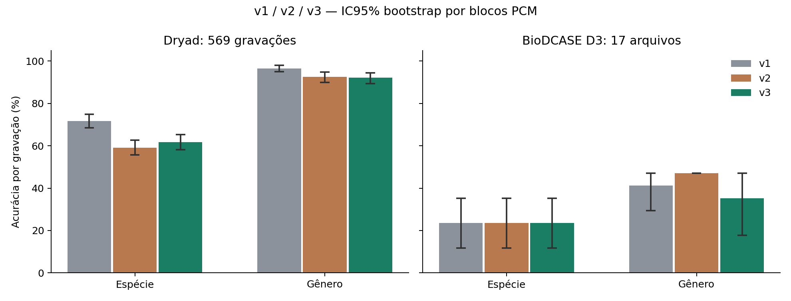

# Ensemble de espécies v3 — 14/10/2026

## Resultado e decisão

Rodada offline concluída: espécie 4/17 e gênero 6/17 no BioDCASE D3 pareado. O piso e a otimização do limiar de gênero foram implementados; não equivalem a confirmação biológica nem a rejeição universal de fontes desconhecidas. **Confiabilidade externa não estabelecida; sem liberação ou compilação para Arduino.** Não houve ajuste por nenhum resultado externo.

**A hipótese não resgatou Aedes aegypti nesta execução.** No Dryad, seus acertos foram 19/20 (v1), 16/20 (v2) e 14/20 (v3); nos quatro externos, 0/4 em todas. Os dois `fresh` conhecidos e os dois arquivos adicionais também tiveram 0/2 na v3. O ganho global de espécie no OOF v2→v3 foi +2,64 pontos, com IC95% pareado [−0,53; +5,80], incluindo zero; a acurácia balanceada ficou praticamente igual (68,54%→68,55%). O acerto nas espécies aceitas caiu de 87,20% para 78,66% internamente. Nos externos, o limiar final não produziu abstenção de gênero: cobertura de 100%, com somente 35,29% de acerto. Portanto, foram corrigidas as regras de extração e busca, mas não a confiabilidade operacional de Aedes nem a confiança externa de gênero.

O motivo da rodada é a hipótese de que zerar c1/c2 e remover a inclinação do PSD sacrificou timbre na v2. O contraste conjunto v2/v3 não isola causalmente cada alteração; não prova que essa foi a única causa do colapso externo. Todos os 17 arquivos, os dois chamados `fresh` da v2 e o Drive já eram conhecidos: continuam retrospectivos nesta rodada. A nova aquisição posterior ao congelamento está separada como `postfreeze_new`.

## Preservação e partições

O diretório v2 real é `results/species_nested_2026_10_13/`; o nome com `species_nested_v2` citado na solicitação não existe e não foi criado nem renomeado. SHA-256 de todos os resultados anteriores, relatórios, firmware, caches, scripts anteriores, testes anteriores, README e MODEL_VALIDATION foram registrados antes das alterações. `verify_freeze` validou v1, v2 e v3; `historical_hashes_*.json` registra a verificação completa. Nenhum artefato histórico foi reescrito.

Reutilizamos exatamente as linhas de fit, calibração e teste da v2, mantendo 24.405 janelas, 613 grupos originais, 560 blocos PCM e 20 espécies. O agrupamento por `pcm_block` conserva o bloco de 54 grupos com rótulos fracos mistos. Bytes dos 818 caminhos de origem foram reconferidos contra `source_pcm_audit.csv`. Não se usaram estatísticas do teste para normalizar, balancear ou selecionar features. A auditoria PCM é limitada a identidade inteira/fragmentos alinhados de 1/.992/.3 s a 8 kHz, com versões de ganho; não prova ausência de derivados arbitrários nem independência de indivíduo/sessão.

v2 e v3 usam as mesmas partições, facilitando o pareamento. A v1 usou outro isolamento; suas colisões PCM atravessavam partições, como documentado na v2. Sua comparação não é uma ablação no mesmo protocolo.

## Frontend v3

- Uma janela mono real de 1 s a 16 kHz, centralizada e normalizada por seu próprio RMS. Não se usa CMN sobre uma gravação inteira ou estatísticas de outros arquivos. O c0 médio fica exatamente zero.
- Subtração de um offset escalar de mediana da envoltória log-mel em cada frame, exclusivamente dentro da janela; c1/c2 e os demais coeficientes médios são preservados, assim como variabilidade e deltas. A v2 zerava c0/c1/c2 e atenuava c3. O log-mel usa potência com piso de ruído local subtraído.
- PSD com subtração da mediana espectral móvel local: 31 bins de 5 Hz abrangem 150 Hz. A v3 não faz regressão/removal da inclinação linear nem escala IQR. Centralização final subtrai somente um offset comum de ganho. Razões h2/h1 e h3/h1 vêm da energia com piso subtraído em bandas ±15 Hz, e não de razões entre contrastes logarítmicos. São limitadas a 100 nas features para estabilizar fundamentais quase ausentes.
- STFT de 100 ms (1600 amostras, hop 160) rastreia o pente harmônico temporal; a de 200 ms (3200, hop 320) estima perfil/peaks com espaçamento de bins de 5 Hz. A grade de candidatos é 200–900 Hz. Espaçamento de 5 Hz não garante erro de estimação de 5 Hz, e hops sobrepostos não criam observações independentes.
- Saliência, três picos, fração de energia harmônica, razões de energia entre faixas e divergência entre tracks curto/longo completam as 308 features. A faixa 500–1600 Hz é um descritor de energia, não uma regra que atribui automaticamente espécie Aedes.

Normalizar ganho e reduzir piso local não garante invariância a qualquer curva de microfone. Resposta de canal e timbre podem ser inseparáveis em uma janela isolada. Pesos espécie/aparelho continuam calculados somente no fit; espécies com um único aparelho declarado continuam confundidas. Testes verificam preservação de c1/c2, relações harmônicas, invariância ao ganho em tolerância numérica e independência bit a bit de outras linhas do lote.

## Ajuste, calibração e limiar

SVM RBF C=3 com StandardScaler somente no fit; ExtraTrees com 200 árvores/max_features=.5/min_samples_leaf=2; HistGradientBoosting com 120 iterações/learning_rate=.08/15 folhas/L2=1. HGB binário e Platt medem presença separadamente. Pesos de bloco PCM/classe/aparelho e MIL foram mantidos: voto por saliência vezes nitidez, top 25/50/100% escolhido somente na calibração. Temperatura, combinação com prior logarítmico e rejeição também usam somente essa partição. Sua reutilização pode gerar otimismo interno; nenhum estimador reentra no ajuste com a calibração.

O gênero é a soma exata das probabilidades calibradas de suas espécies. Seu piso é 1/4+.05=0.30. A busca maximiza acurácia aceita vezes raiz da cobertura, sujeita a acurácia de calibração ≥90% e ≥20 blocos PCM distintos aceitos. Candidatos e objetivo completo estão em `calibration_*.json`; ausência de candidato qualificado rejeita tudo com 1.000001. A regra não força um corte adicional quando todas as decisões já satisfazem o objetivo. O limiar pode ficar no piso, mas nunca em zero; isso não significa que a calibração transfere ao domínio externo.

| Dobra | Limiar v2 de gênero | Piso v3 | Limiar v3 | Objetivo na calibração | Cobertura na calibração | Acerto na calibração |
|---|---:|---:|---:|---:|---:|---:|
| 0 | 0.000000 | 0.300000 | 0.300000 | 0.9487 | 100.00% | 94.87% |
| 1 | 0.000000 | 0.300000 | 0.502846 | 0.9801 | 97.64% | 99.19% |
| 2 | 0.000000 | 0.300000 | 0.556672 | 0.9619 | 95.83% | 98.26% |
| final | 0.000000 | 0.300000 | 0.530334 | 0.9869 | 99.13% | 99.12% |

Um diagnóstico da confiança hierárquica: as 20 classes têm 12 Anopheles, quatro Aedes, três Culex e uma Culiseta. Se as probabilidades finais de espécie forem uniformes (0,05 cada), a marginalização já produz P(Anopheles)=0,60. Esse valor passa pelo limiar final de 0,530334 sem evidência discriminativa por espécie. O exemplo é algébrico, não uma afirmação de que todos os arquivos externos têm probabilidades uniformes. Ele mostra por que um piso não zero, sozinho, não resolve incerteza de domínio ou multiplicidade das espécies de cada gênero. Nenhum ajuste foi feito a partir desse diagnóstico pós-avaliação.

## Congelamento e cronologia

Todas as bases, transformações, temperaturas, pesos, regras MIL e limiares das três dobras e do ajuste final foram congelados em **2026-10-14T04:24:14.585267+00:00 UTC**, antes da primeira predição de qualquer teste OOF ou externo. Hash de `freeze.json`: `d949fe8d7b1ea1c4f20b017d85e11d586a95d60c56cb7e8de8105141d747a53a`. `manifest.json` registra SHA-256 dos pesos, calibrações, protocolo e features. `evaluation_started.json` e `evaluation_audit.json` comprovam a ordem. A extração prévia de features de teste era determinística por janela, sem estatística de lote nem ajuste supervisionado. Modelos e inferência avaliam cada janela da mesma forma isolada ou em lote.

Após o congelamento foi feita busca na fonte oficial [BioDCASE/Zenodo](https://zenodo.org/records/19095788) e aquisição por ID/duração predefinidos. Foram aceitos 2 arquivos ainda não usados; 0 exclusões registradas, sem reposição por previsões. Forks Apple/fixtures incompatíveis têm seus bytes indexados e erros de PCM explicitamente registrados, não são anunciados como PCM auditado. Arquivos novos são de um corpus familiar, sem identidade biológica/sessão confirmada: não uma campanha independente. Os dois arquivos `fresh` da v2 permanecem apenas comparadores conhecidos.

## Comparação por gravação

| Base | Nível | Versão | n | Acurácia | Balanceada | F1 suporte | F1 união estrita | Cobertura | Acerto aceitas |
|---|---|---|---:|---:|---:|---:|---:|---:|---:|
| dryad | species | v1 | 569 | 71.70% | 76.60% | 73.19% | 73.19% | 61.69% | 88.89% |
| dryad | species | v2 | 569 | 59.05% | 68.54% | 57.37% | 57.37% | 28.82% | 87.20% |
| dryad | species | v3 | 569 | 61.69% | 68.55% | 59.13% | 59.13% | 28.82% | 78.66% |
| dryad | genus_marginalized | v1 | 569 | 96.49% | 93.66% | 94.45% | 94.45% | 100.00% | 96.49% |
| dryad | genus_marginalized | v2 | 569 | 92.44% | 90.75% | 88.88% | 88.88% | 100.00% | 92.44% |
| dryad | genus_marginalized | v3 | 569 | 92.09% | 89.81% | 90.67% | 90.67% | 96.31% | 93.61% |
| external | species | v1 | 17 | 23.53% | 20.00% | 21.33% | 9.70% | 47.06% | 25.00% |
| external | species | v2 | 17 | 23.53% | 20.00% | 21.67% | 10.83% | 58.82% | 30.00% |
| external | species | v3 | 17 | 23.53% | 20.00% | 25.14% | 13.97% | 64.71% | 27.27% |
| external | genus_marginalized | v1 | 17 | 41.18% | 29.17% | 23.33% | 23.33% | 100.00% | 41.18% |
| external | genus_marginalized | v2 | 17 | 47.06% | 33.33% | 25.40% | 25.40% | 100.00% | 47.06% |
| external | genus_marginalized | v3 | 17 | 35.29% | 25.00% | 21.05% | 15.79% | 100.00% | 35.29% |
| fresh | species | v1 | 2 | 0.00% | 0.00% | 0.00% | 0.00% | 50.00% | 0.00% |
| fresh | species | v2 | 2 | 0.00% | 0.00% | 0.00% | 0.00% | 50.00% | 0.00% |
| fresh | species | v3 | 2 | 0.00% | 0.00% | 0.00% | 0.00% | 0.00% | indefinido |
| fresh | genus_marginalized | v1 | 2 | 0.00% | 0.00% | 0.00% | 0.00% | 100.00% | 0.00% |
| fresh | genus_marginalized | v2 | 2 | 0.00% | 0.00% | 0.00% | 0.00% | 100.00% | 0.00% |
| fresh | genus_marginalized | v3 | 2 | 0.00% | 0.00% | 0.00% | 0.00% | 100.00% | 0.00% |
| drive | species | v1 | 1 | 0.00% | 0.00% | 0.00% | 0.00% | 0.00% | indefinido |
| drive | species | v2 | 1 | 0.00% | 0.00% | 0.00% | 0.00% | 0.00% | indefinido |
| drive | species | v3 | 1 | 0.00% | 0.00% | 0.00% | 0.00% | 0.00% | indefinido |
| drive | genus_marginalized | v1 | 1 | 0.00% | 0.00% | 0.00% | 0.00% | 0.00% | indefinido |
| drive | genus_marginalized | v2 | 1 | 0.00% | 0.00% | 0.00% | 0.00% | 100.00% | 0.00% |
| drive | genus_marginalized | v3 | 1 | 0.00% | 0.00% | 0.00% | 0.00% | 100.00% | 0.00% |
| postfreeze_new | species | v1 | 2 | 0.00% | 0.00% | 0.00% | 0.00% | 50.00% | 0.00% |
| postfreeze_new | species | v2 | 2 | 0.00% | 0.00% | 0.00% | 0.00% | 0.00% | indefinido |
| postfreeze_new | species | v3 | 2 | 0.00% | 0.00% | 0.00% | 0.00% | 50.00% | 0.00% |
| postfreeze_new | genus_marginalized | v1 | 2 | 0.00% | 0.00% | 0.00% | 0.00% | 100.00% | 0.00% |
| postfreeze_new | genus_marginalized | v2 | 2 | 0.00% | 0.00% | 0.00% | 0.00% | 100.00% | 0.00% |
| postfreeze_new | genus_marginalized | v3 | 2 | 0.00% | 0.00% | 0.00% | 0.00% | 100.00% | 0.00% |

A tabela taxonômica é sem gate de presença, para manter a comparação histórica. Colunas/métricas adicionais com gate estão nos CSVs. Qualidade antiga exige todas as janelas válidas por arquivo; v2/v3 permitem votar com as janelas válidas selecionadas por MIL. Inválidos continuam nos denominadores e não contam como negativos corretos. Coberturas diferentes também decorrem dessa política; acerto nas emissões compara subconjuntos potencialmente distintos.

## Intervalos pareados

| Base | Nível | Δ acurácia v3−v2 (p.p.) | IC95% pareado | Δ F1 estrito | IC95% pareado |
|---|---|---:|---|---:|---|
| dryad | species | +2.64 | [-0.53; +5.80] | +1.76 | [-1.75; +4.96] |
| dryad | genus_marginalized | -0.35 | [-2.32; +1.55] | +1.79 | [-1.28; +4.82] |
| external | species | +0.00 | [-23.53; +23.53] | +3.13 | [-8.98; +13.33] |
| external | genus_marginalized | -11.76 | [-29.41; +0.00] | -9.61 | [-16.02; +0.00] |
| fresh | species | +0.00 | [+0.00; +0.00] | +0.00 | [+0.00; +0.00] |
| fresh | genus_marginalized | +0.00 | [+0.00; +0.00] | +0.00 | [+0.00; +0.00] |
| postfreeze_new | species | +0.00 | [+0.00; +0.00] | +0.00 | [+0.00; +0.00] |
| postfreeze_new | genus_marginalized | +0.00 | [+0.00; +0.00] | +0.00 | [+0.00; +0.00] |

`bootstrap_intervals.json` contém todos os IC95% e diferenças v3−v1/v3−v2. São 2.000 réplicas percentis, semente 20261014, com os mesmos sorteios de blocos PCM para os modelos, estratificadas por conjunto de rótulos verdadeiro do bloco. F1 usa a união de rótulos observados verdadeiros/preditos na réplica. Sem emissões, acerto aceito fica indefinido e conta-se a quantidade de réplicas válidas. Estratos únicos ou desfechos homogêneos podem produzir intervalos degenerados; largura zero não demonstra precisão populacional. O Drive é uma só gravação e não recebe IC independente por janelas. Comparações múltiplas são exploratórias.

F1 por suporte continua penalizando falsos positivos ausentes via falsos negativos das classes verdadeiras; F1 de união também inclui explicitamente os táxons espúrios com F1 zero. Não se interpretam os 17 arquivos de cinco espécies como confirmação das 20 classes.

## Aedes aegypti e gênero

| Base | n Ae. aegypti | Acertos v1 | Acertos v2 | Acertos v3 |
|---|---:|---:|---:|---:|
| dryad | 20 | 19 | 16 | 14 |
| external | 4 | 0 | 0 | 0 |
| fresh | 2 | 0 | 0 | 0 |
| drive | 1 | 0 | 0 | 0 |
| postfreeze_new | 2 | 0 | 0 | 0 |

| Base | Versão | Acurácia gênero da espécie vencedora | Acurácia gênero marginalizado |
|---|---|---:|---:|
| dryad | v1 | 94.73% | 96.49% |
| dryad | v2 | 89.28% | 92.44% |
| dryad | v3 | 86.47% | 92.09% |
| drive | v1 | 0.00% | 0.00% |
| drive | v2 | 0.00% | 0.00% |
| drive | v3 | 0.00% | 0.00% |
| external | v1 | 41.18% | 41.18% |
| external | v2 | 47.06% | 47.06% |
| external | v3 | 47.06% | 35.29% |
| fresh | v1 | 0.00% | 0.00% |
| fresh | v2 | 0.00% | 0.00% |
| fresh | v3 | 0.00% | 0.00% |
| postfreeze_new | v1 | 0.00% | 0.00% |
| postfreeze_new | v2 | 50.00% | 0.00% |
| postfreeze_new | v3 | 0.00% | 0.00% |

Todas as espécies têm métricas por táxon e matrizes de confusão em `per_taxon.csv` e `confusion_matrices/`; táxons ausentes não recebem sensibilidade inventada. Avaliar a hipótese de timbre exige futuras ablações internas, sem escolher a arquitetura pelos externos já examinados.

## Presença e enxame privado

| Base | Positivos | Negativos | Sensibilidade | Especificidade | Balanceada |
|---|---:|---:|---:|---:|---:|
| dryad | 569 | 44 | 81.72% | 77.27% | 79.50% |
| drive | 1 | 0 | 0.00% | indefinido | 0.00% |
| external | 17 | 0 | 29.41% | indefinido | 29.41% |
| fresh | 2 | 0 | 0.00% | indefinido | 0.00% |
| postfreeze_new | 2 | 0 | 50.00% | indefinido | 50.00% |

Externos sem ausência/ruído medem sensibilidade, não validam precisão/especificidade. O detector histórico de presença tinha outro protocolo/unidade e não foi anunciado como comparação pareada.

O Drive possui 106.24 s: 106 janelas completas e 0.24 s finais não analisados por não completar 1 s. 2 janelas inválidas permaneceram no denominador. Na v3 houve 2/106 escolhas corretas de espécie por janela, apenas diagnóstico descritivo. Candidata por gravação: **Anopheles gambiae**; gênero: **Anopheles**; espécie aceita: False; gênero aceito: True; presença detectada: False. Referência do usuário: Aedes aegypti em todo o arquivo, sem anotação entomológica de eventos independente. O áudio privado não foi copiado ou publicado.

## Testes, artefatos e limites

Linha de base: 156 testes passaram. Suíte final: **177 passed, 13209 warnings in 27.86s**, `.venv/bin/python -m pytest -q tests`, status 0. Logs de avisos ficam preservados. Testes novos cobrem PCM, comportamento indutivo, ganho/timbre/energia harmônica, STFTs, critério de confiança, candidatos de calibração, congelamento anterior a OOF/externos, pares 17+2 e preservação histórica. Todos os resultados e figuras novos estão em `results/species_nested_v3_2026_10_14/`; somente este relatório novo foi escrito em `reports/`. README, MODEL_VALIDATION, relatórios e firmware anteriores permaneceram intactos.

Os critérios de MODEL_VALIDATION exigem métricas e limites inferiores ≥60% em aquisição adequada, inclusive entre mosquitos e táxons negativos. A amostra externa pequena, conhecida em parte, sem negativos suficientes e sem novos indivíduos/sessões confirmados não satisfaz esse conjunto de critérios. Mesmo melhora pontual não autoriza firmware. A próxima confirmação deve trazer outros aparelhos/ambientes, espécies/sexo/indivíduos conhecidos, controles de ruído, múltiplos enxames e anotação temporal, com modelos congelados e falsos alarmes por hora.

## Referências

- [SciPy STFT](https://docs.scipy.org/doc/scipy/reference/generated/scipy.signal.stft.html): relação entre nperseg, sobreposição e eixos de frequência/tempo.
- [Rosenberg et al., 1994, normalização cepstral de canal](https://www.isca-archive.org/icslp_1994/rosenberg94_icslp.html): contexto de compensação de canal; a centralização escalar intra-janela aqui não é reprodução de CMN por gravação nem garantia de remoção completa de canal.
