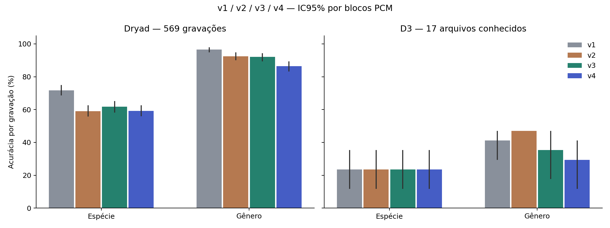

# Ensemble de espécies v4 — 14/10/2026

## Resultado e decisão

Rodada offline concluída. Nos mesmos 17 arquivos BioDCASE D3: espécie **4/17**, gênero corrigido **5/17**, gênero pós-hoc **5/17**. Cobertura e acerto nas emissões estão abaixo; escolha forçada não equivale a detecção. **Confiabilidade externa não estabelecida; sem liberação para Arduino.** Nenhum hiperparâmetro foi alterado por resultados externos.

As quatro alterações são uma hipótese conjunta motivada por testes externos já examinados. Este contraste não isola causas: não prova causalmente que cada gargalo é um bug ou que sua correção recuperará Ae. aegypti. Soma exata de probabilidades não é matematicamente errada por existir mais espécies de Anopheles; seu prior e calibração podem ser inadequados à aplicação. A v4 muda esse prior e a regra de agregação, com seleção interna explícita.

## Preservação e isolamento

Os **1239 arquivos históricos** registrados antes da implementação mantiveram SHA-256. verify_freeze verificou v1/v2/v3/v4; verify_history inclui resultados, relatórios, firmware e fontes anteriores. O diretório v2 real permanece `results/species_nested_2026_10_13/`. README.md e MODEL_VALIDATION.md também são históricos congelados: conforme a escolha expressa do usuário, permanecem intactos; as atualizações são README_v4.md e MODEL_VALIDATION_v4.md. Nenhum firmware, header ou instalador foi alterado/compilado.

Reutilizamos exatamente as partições v2/v3: 24.405 janelas, 613 grupos, 560 blocos PCM, 20 espécies. Fit, calibration e outer test são disjuntos por bloco, grupo, caminho e colisão auditada; scaler e pesos espécie/aparelho/bloco usam somente fit. As bases são SVM RBF, ExtraTrees e HistGradientBoosting; parâmetros-base mantidos. Nenhuma base é reajustada com calibration. A v1 tem outro isolamento e colisões já documentadas: não é ablação equivalente.

## Frontend e teste de piso estacionário

PSD usa `10log10(power/local_median_power)`, limitado a [−6,+45] dB, interpolado e centralizado pela mediana. Mel usa `MEL_BANK_SHORT @ (short/local_floor)`, log com piso 1e−6, mediana por frame e DCT, com c0=0 e c1/c2 preservados. Não se tira log de uma subtração linear truncada em zero. Energia harmônica com piso subtraído permanece apenas nos descritores físicos de energia; não alimenta os logs PSD/Mel. STFTs 100/200 ms mantêm resolução temporal e bins 10/5 Hz.

Toda transformação opera dentro de uma única janela real de 1 s. O teste SNR 25→12 dB verifica forma PSD/MFCC (cosseno >.97), RMS de alteração do PSD <3 dB, fundamental dentro de 5 Hz e saliência dentro de .1, em sinais de 400 e 625 Hz. Isso não é invariância absoluta a qualquer ruído: elevar ruído altera a razão sinal/piso e as amplitudes cepstrais. A demonstração de 400 Hz deu cossenos PSD≈.9922/MFCC≈.9965 e alteração relativa de amplitude do bloco MFCC≈39.7%. Em 625 Hz o cosseno MFCC≈.9776 reprova um critério mais forte >.98; mantivemos esse caso no teste e registramos a fronteira, sem alterar a fórmula para selecioná-lo favoravelmente. Não se anuncia a amplitude como invariável. Ganho escalar, silêncio e independência bit a bit de outras janelas têm testes próprios. Canal arbitrário, ruído colorido e enxames múltiplas espécies continuam limitações.

## Calibração de espécie, gênero e MIL

Pesos da mistura são ajustados por log-loss balanceada em calibration. Temperatura pós-mistura [0.75,1,1.25,1.5,2] e força [0,.25,.5,.75,1] de log-prior inverso de frequência são selecionadas exclusivamente em recordings de calibration. Frequência é contagem de blocos PCM distintos por espécie da própria calibration; viés absoluto ≤.8 (fator máximo exp(.8)). Objetivo: média de balanced accuracy e soft macro-F1 ponderado por espécie/bloco, em MIL provisório .35; desempate por log-loss balanceada e menor viés. Isso limita prevalência, sem atribuir privilégio manual a Aedes. Espécies com 1 bloco de calibração continuam frágeis.

Gênero corrigido usa `S_G=(sum(p_s**tau)/m_G**gamma)**(1/tau)` e normalização. γ∈[0,.25,.5,.75,1], τ∈[1,1.5,2,3]. Objetivo interno: `.5*(balanced_accuracy + exp(-balanced_log_loss)) - .05*KL(null || uniform_genera)`. O exponencial torna o termo de log-loss um escore crescente de qualidade; não se soma log-loss positiva a acurácia. Candidatos cuja distribuição de 20 espécies uniformes produza máximo ≥.30 são inelegíveis. γ=0,τ=1 recupera soma exata, mas seu nulo .60 viola a restrição deste catálogo. A distribuição normaliza a 1, porém **não é o posterior exato marginalizado** fora desse caso especial; o nome da coluna histórica é mantido para pareamento.

Limiar de gênero maximiza acurácia aceita×√cobertura, exigindo acurácia interna ≥90% e ≥20 blocos PCM aceitos, piso .30; sem candidato qualificado rejeita tudo. Espécie conserva a regra de rejeição interna anterior. Seleção de temperatura/prior/MIL/taxonomia/limiar reutiliza calibration e pode ser otimista; outer test e externos ficam excluídos de toda seleção.

MIL seleciona [.20,.35,.50,.65] em calibration; gravações com >4 janelas não podem selecionar todas. Peso de espécie por janela = saliência×(1−H/logK)×(.15+.85×presença calibrada). Ranking usa esse peso, qualidade exclui voto inválido e nitidez numericamente uniforme é zero. Até quatro janelas usam todas. Presença é treinada e calibrada separadamente e agregada sem autoponderação de presença; também tem seleção MIL interna e controle FPR interno. A regra reduz influência de fundos uniformes; **não garante** rejeitar ruído que o próprio modelo reconheça erroneamente com alta confiança.

| Dobra | MIL espécie | γ | τ | Máximo nulo | Limiar gênero | T mistura | Força prior |
|---|---:|---:|---:|---:|---:|---:|---:|
| 0 | 0.50 | 0.75 | 2.00 | 0.290227 | 0.658597 | 0.75 | 0.50 |
| 1 | 0.35 | 0.75 | 3.00 | 0.276520 | 0.510193 | 0.75 | 0.75 |
| 2 | 0.35 | 0.75 | 2.00 | 0.290227 | 0.450814 | 1.00 | 0.50 |
| final | 0.35 | 0.75 | 2.00 | 0.290227 | 0.505584 | 0.75 | 0.50 |

## Congelamento, aquisição e avaliação

Todos os modelos, fontes, transformações e limiares foram congelados em **2026-10-14T05:45:30.802393+00:00 UTC**, SHA-256 de freeze.json `15ba7c77981e660d7fbd41f9243b5384abc222e3016536bc3370e2c7a001aab1`, antes de qualquer predição outer OOF ou externa. Manifesto registra pesos, códigos, entradas e configurações; evaluation_started.json/evaluation_audit.json registram a sequência. Extração prévia determinística não ajusta estatísticas do teste.

17 externos, fresh da v2 (83/84), postfreeze_new da v3 (85/86) e Drive são conhecidos, retrospectivos. Depois do congelamento, busca oficial e seleção numérica determinística adquiriram **2 arquivos** separados em postfreeze_new_v4: S_1_D_3_87.wav, S_1_D_3_88.wav. SHA/CRC/tamanho/duração e PCM inteiro/fragmentos alinhados de 1/.992/.3 s a 8 kHz, com variantes de ganho, foram conferidos antes de predição, incluindo todos os WAVs anteriores em results. Erros de decodificação e limites estão em fresh_selection_v4.json. Não se substituiu candidato por resultado. Esse corpus familiar não estabelece novos indivíduos/sessões nem uma campanha independente; auditoria alinhada não exclui todos os derivados arbitrários.

## Comparação completa por gravação

| Base | Nível | Versão | n | Acurácia | Balanceada | F1 suporte | F1 união estrita | Cobertura | Acerto aceitas |
|---|---|---|---:|---:|---:|---:|---:|---:|---:|
| dryad | species | v1 | 569 | 71.70% | 76.60% | 73.19% | 73.19% | 61.69% | 88.89% |
| dryad | species | v2 | 569 | 59.05% | 68.54% | 57.37% | 57.37% | 28.82% | 87.20% |
| dryad | species | v3 | 569 | 61.69% | 68.55% | 59.13% | 59.13% | 28.82% | 78.66% |
| dryad | species | v4 | 569 | 59.23% | 65.55% | 57.20% | 57.20% | 11.07% | 77.78% |
| dryad | genus_marginalized | v1 | 569 | 96.49% | 93.66% | 94.45% | 94.45% | 100.00% | 96.49% |
| dryad | genus_marginalized | v2 | 569 | 92.44% | 90.75% | 88.88% | 88.88% | 100.00% | 92.44% |
| dryad | genus_marginalized | v3 | 569 | 92.09% | 89.81% | 90.67% | 90.67% | 96.31% | 93.61% |
| dryad | genus_marginalized | v4 | 569 | 86.47% | 87.19% | 83.65% | 83.65% | 89.63% | 88.24% |
| external | species | v1 | 17 | 23.53% | 20.00% | 21.33% | 9.70% | 47.06% | 25.00% |
| external | species | v2 | 17 | 23.53% | 20.00% | 21.67% | 10.83% | 58.82% | 30.00% |
| external | species | v3 | 17 | 23.53% | 20.00% | 25.14% | 13.97% | 64.71% | 27.27% |
| external | species | v4 | 17 | 23.53% | 20.00% | 23.00% | 11.50% | 41.18% | 42.86% |
| external | genus_marginalized | v1 | 17 | 41.18% | 29.17% | 23.33% | 23.33% | 100.00% | 41.18% |
| external | genus_marginalized | v2 | 17 | 47.06% | 33.33% | 25.40% | 25.40% | 100.00% | 47.06% |
| external | genus_marginalized | v3 | 17 | 35.29% | 25.00% | 21.05% | 15.79% | 100.00% | 35.29% |
| external | genus_marginalized | v4 | 17 | 29.41% | 20.83% | 16.67% | 12.50% | 100.00% | 29.41% |
| fresh | species | v1 | 2 | 0.00% | 0.00% | 0.00% | 0.00% | 50.00% | 0.00% |
| fresh | species | v2 | 2 | 0.00% | 0.00% | 0.00% | 0.00% | 50.00% | 0.00% |
| fresh | species | v3 | 2 | 0.00% | 0.00% | 0.00% | 0.00% | 0.00% | indefinido |
| fresh | species | v4 | 2 | 0.00% | 0.00% | 0.00% | 0.00% | 0.00% | indefinido |
| fresh | genus_marginalized | v1 | 2 | 0.00% | 0.00% | 0.00% | 0.00% | 100.00% | 0.00% |
| fresh | genus_marginalized | v2 | 2 | 0.00% | 0.00% | 0.00% | 0.00% | 100.00% | 0.00% |
| fresh | genus_marginalized | v3 | 2 | 0.00% | 0.00% | 0.00% | 0.00% | 100.00% | 0.00% |
| fresh | genus_marginalized | v4 | 2 | 0.00% | 0.00% | 0.00% | 0.00% | 100.00% | 0.00% |
| postfreeze_new | species | v1 | 2 | 0.00% | 0.00% | 0.00% | 0.00% | 50.00% | 0.00% |
| postfreeze_new | species | v2 | 2 | 0.00% | 0.00% | 0.00% | 0.00% | 0.00% | indefinido |
| postfreeze_new | species | v3 | 2 | 0.00% | 0.00% | 0.00% | 0.00% | 50.00% | 0.00% |
| postfreeze_new | species | v4 | 2 | 0.00% | 0.00% | 0.00% | 0.00% | 0.00% | indefinido |
| postfreeze_new | genus_marginalized | v1 | 2 | 0.00% | 0.00% | 0.00% | 0.00% | 100.00% | 0.00% |
| postfreeze_new | genus_marginalized | v2 | 2 | 0.00% | 0.00% | 0.00% | 0.00% | 100.00% | 0.00% |
| postfreeze_new | genus_marginalized | v3 | 2 | 0.00% | 0.00% | 0.00% | 0.00% | 100.00% | 0.00% |
| postfreeze_new | genus_marginalized | v4 | 2 | 0.00% | 0.00% | 0.00% | 0.00% | 50.00% | 0.00% |
| postfreeze_new_v4 | species | v1 | 2 | 0.00% | 0.00% | 0.00% | 0.00% | 50.00% | 0.00% |
| postfreeze_new_v4 | species | v2 | 2 | 0.00% | 0.00% | 0.00% | 0.00% | 0.00% | indefinido |
| postfreeze_new_v4 | species | v3 | 2 | 0.00% | 0.00% | 0.00% | 0.00% | 50.00% | 0.00% |
| postfreeze_new_v4 | species | v4 | 2 | 0.00% | 0.00% | 0.00% | 0.00% | 0.00% | indefinido |
| postfreeze_new_v4 | genus_marginalized | v1 | 2 | 0.00% | 0.00% | 0.00% | 0.00% | 100.00% | 0.00% |
| postfreeze_new_v4 | genus_marginalized | v2 | 2 | 0.00% | 0.00% | 0.00% | 0.00% | 100.00% | 0.00% |
| postfreeze_new_v4 | genus_marginalized | v3 | 2 | 0.00% | 0.00% | 0.00% | 0.00% | 100.00% | 0.00% |
| postfreeze_new_v4 | genus_marginalized | v4 | 2 | 0.00% | 0.00% | 0.00% | 0.00% | 50.00% | 0.00% |
| drive | species | v1 | 1 | 0.00% | 0.00% | 0.00% | 0.00% | 0.00% | indefinido |
| drive | species | v2 | 1 | 0.00% | 0.00% | 0.00% | 0.00% | 0.00% | indefinido |
| drive | species | v3 | 1 | 0.00% | 0.00% | 0.00% | 0.00% | 0.00% | indefinido |
| drive | species | v4 | 1 | 0.00% | 0.00% | 0.00% | 0.00% | 0.00% | indefinido |
| drive | genus_marginalized | v1 | 1 | 0.00% | 0.00% | 0.00% | 0.00% | 0.00% | indefinido |
| drive | genus_marginalized | v2 | 1 | 0.00% | 0.00% | 0.00% | 0.00% | 100.00% | 0.00% |
| drive | genus_marginalized | v3 | 1 | 0.00% | 0.00% | 0.00% | 0.00% | 100.00% | 0.00% |
| drive | genus_marginalized | v4 | 1 | 0.00% | 0.00% | 0.00% | 0.00% | 0.00% | indefinido |

São métricas taxonômicas sem gate para parear com históricos; CSV também inclui gate de presença e soma bruta de gênero v4. Inválidos e rejeições permanecem nos denominadores; acerto aceito sem emissões fica indefinido. F1 suporte usa apenas táxons verdadeiros; F1 união inclui explicitamente os previstos fora do suporte. Coberturas diferentes representam subconjuntos distintos e não autorizam comparar precisão como se fossem as mesmas emissões.

## Diferenças pareadas

| Base | Nível | Δ acurácia v4−v3 (p.p.) | IC95% pareado | Δ F1 união estrita (p.p.) | IC95% pareado |
|---|---|---:|---|---:|---|
| dryad | species | -2.46 | [-5.62; +0.70] | -1.94 | [-6.86; +2.58] |
| dryad | genus_marginalized | -5.62 | [-8.32; -3.29] | -7.02 | [-11.08; -2.98] |
| external | species | +0.00 | [+0.00; +0.00] | -2.47 | [-4.64; +0.00] |
| external | genus_marginalized | -5.88 | [-17.65; +0.00] | -3.29 | [-8.52; -0.65] |
| fresh | species | +0.00 | [+0.00; +0.00] | +0.00 | [+0.00; +0.00] |
| fresh | genus_marginalized | +0.00 | [+0.00; +0.00] | +0.00 | [+0.00; +0.00] |
| postfreeze_new | species | +0.00 | [+0.00; +0.00] | +0.00 | [+0.00; +0.00] |
| postfreeze_new | genus_marginalized | +0.00 | [+0.00; +0.00] | +0.00 | [+0.00; +0.00] |
| postfreeze_new_v4 | species | +0.00 | [+0.00; +0.00] | +0.00 | [+0.00; +0.00] |
| postfreeze_new_v4 | genus_marginalized | +0.00 | [+0.00; +0.00] | +0.00 | [+0.00; +0.00] |
| drive | species | +0.00 | não estimável | +0.00 | não estimável |
| drive | genus_marginalized | +0.00 | não estimável | +0.00 | não estimável |

IC95% percentis, 2.000 réplicas, seed 20261014, sorteios pareados por bloco PCM estratificados pelo conjunto de rótulos verdadeiro. A união para F1 é recalculada em cada réplica. Réplicas sem emissões não viram acerto zero; sua quantidade válida é registrada. Estratos pequenos e métricas constantes podem gerar intervalos degenerados, sem precisão populacional demonstrada. Drive tem uma gravação, sem IC por janelas. Todas as comparações são exploratórias, sem correção de multiplicidade.

## Ae. aegypti e as três regras de gênero

| Base | n Ae. aegypti | Acertos v1 | Acertos v2 | Acertos v3 | Acertos v4 |
|---|---:|---:|---:|---:|---:|
| dryad | 20 | 19 | 16 | 14 | 18 |
| external | 4 | 0 | 0 | 0 | 0 |
| fresh | 2 | 0 | 0 | 0 | 0 |
| postfreeze_new | 2 | 0 | 0 | 0 | 0 |
| postfreeze_new_v4 | 2 | 0 | 0 | 0 | 0 |
| drive | 1 | 0 | 0 | 0 | 0 |

| Base | Versão | Gênero pós-hoc | Soma exata v4 | Gênero principal |
|---|---|---:|---:|---:|
| dryad | v1 | 94.73% | — | 96.49% |
| dryad | v2 | 89.28% | — | 92.44% |
| dryad | v3 | 86.47% | — | 92.09% |
| dryad | v4 | 86.47% | 89.28% | 86.47% |
| external | v1 | 41.18% | — | 41.18% |
| external | v2 | 47.06% | — | 47.06% |
| external | v3 | 47.06% | — | 35.29% |
| external | v4 | 29.41% | 41.18% | 29.41% |
| fresh | v1 | 0.00% | — | 0.00% |
| fresh | v2 | 0.00% | — | 0.00% |
| fresh | v3 | 0.00% | — | 0.00% |
| fresh | v4 | 0.00% | 0.00% | 0.00% |
| postfreeze_new | v1 | 0.00% | — | 0.00% |
| postfreeze_new | v2 | 50.00% | — | 0.00% |
| postfreeze_new | v3 | 0.00% | — | 0.00% |
| postfreeze_new | v4 | 0.00% | 0.00% | 0.00% |
| postfreeze_new_v4 | v1 | 0.00% | — | 0.00% |
| postfreeze_new_v4 | v2 | 0.00% | — | 0.00% |
| postfreeze_new_v4 | v3 | 0.00% | — | 0.00% |
| postfreeze_new_v4 | v4 | 0.00% | 0.00% | 0.00% |
| drive | v1 | 0.00% | — | 0.00% |
| drive | v2 | 0.00% | — | 0.00% |
| drive | v3 | 0.00% | — | 0.00% |
| drive | v4 | 0.00% | 0.00% | 0.00% |

O diagnóstico taxonômico de v3 favorecia Anopheles sob incerteza difusa; v4 mede separadamente soma exata, pós-hoc e agregação corrigida. Per_taxon.csv e matrizes trazem todos os táxons, incluindo falsos positivos fora do suporte. Acurácia total não substitui sensibilidade de Ae. aegypti nem prova efeito causal individual das quatro alterações.

## Presença, Drive e limites

O Drive tem 106.24 s, 106 janelas completas, 2 inválidas e 0.24 s finais não completados/padronizados. MIL votou com 38 janelas selecionadas. Candidata v4 **Anopheles gambiae**; gênero corrigido **Anopheles**; presença False; espécie aceita False; gênero aceito False. Diagnóstico por janela: 6/106 escolhas corretas, sem IC independente. Referência do usuário: enxame Ae. aegypti, sem confirmação entomológica/anotação independente. O WAV privado não foi publicado.

Presença por recording está em comparison_metrics.csv, separada de gênero/espécie, com sensibilidade/especificidade e quantidade de positivos/negativos. Externos somente positivos não medem especificidade/precisão de presença. Os critérios de MODEL_VALIDATION exigem ≥60% e limites inferiores apropriados por táxon/entre mosquitos em aquisição adequada, além de confirmação independente no cenário pretendido. Esses requisitos de evidência não são satisfeitos por uma amostra pequena e familiar ou por um enxame isolado. Não houve distribuição embarcada.

## Testes e artefatos

Linha de base **177 passed**. Suíte final **202 passed, 49273 warnings in 37.52s**, status 0, sem alteração de testes anteriores. Os novos testes cobrem piso logarítmico/ruído estacionário, ganho, c0/c1/c2, bit-indução, colisões PCM, fórmula taxonômica e nulo abaixo do piso, MIL seletivo/presença, prior limitado, histórico, scaler-fit e cronologia congelamento/aquisição/avaliação. Logs preservam avisos conhecidos.

Fontes novas: acoustic_features_v4.py, nested_species_ensemble_v4.py, fetch_species_v4_fresh.py, compare_species_v4.py e tests/test_nested_species_v4.py. Resultados, curvas, previsões por janela/gravação, bootstrap, matrizes, figuras e manifestos ficam somente em results/species_nested_v4_2026_10_14/. Relatório histórico algum foi reescrito.
