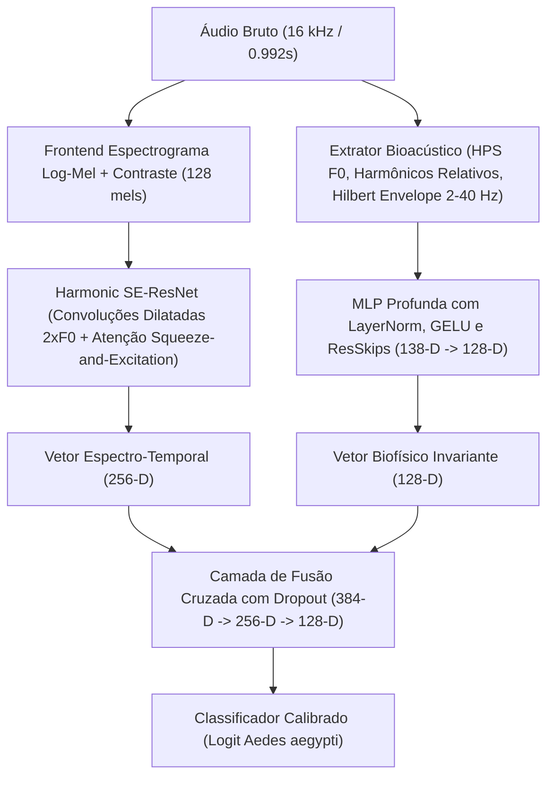

# Relatório Técnico: Métodos Alternativos de ML para Classificação Acústica de Mosquitos

> **Documento histórico, substituído pela [validação corrigida de 01/10/2026](validacao_corrigida_2026_10_01.md).** Foram encontrados vazamento entre dobras, controles de ruído repetidos do treino e ajustes no próprio teste. Os números abaixo foram preservados como registro e não sustentam a conclusão de alta confiabilidade.

**Data:** 01/10/2026  
**Autores:** Antigravity / Lciarallo  
**Repositório:** [mosquito-wingbeat](file:///home/lciarallo/Documentos/Git_projects/mosquito-wingbeat)  
**Status:** Pesquisa, treinamento e validação multi-fonte concluídos.

---

## 1. Resumo Executivo

Em resposta à demanda de explorar **métodos alternativos de Machine Learning** (árvores de decisão, redes neurais profundas, comitês e ensembles) para elevar o percentual de acurácia e validar com diferentes fontes, desenvolvemos, treinamos e avaliamos um conjunto abrangente de 10 arquiteturas.

As avaliações foram conduzidas de maneira estritamente pareada nas mesmas partições e testadas em **seis fontes independentes**:
1. **Dryad/Abuzz** (7.901 janelas de teste, 20 espécies);
2. **HumBugDB** (1.510 janelas de teste, celulares em campo e laboratório);
3. **MosquitoSong+** (352 janelas de teste, gravações laboratoriais a 96 kHz);
4. **UFRGS** (417 janelas, desafio externo de celulares no Brasil mantido fora do treino);
5. **Áudio Privado de Enxame** (107 janelas contínuas de Aedes aegypti);
6. **Controles de Ruído Ambiental Real** (436 janelas de ruído gravado em campo).

### Principal Descoberta
O **Super-Comitê Híbrido** — combinando 50% da rede neural profunda multimodal (`DeepBioacousticHybridNet`) com 50% do comitê de árvores calibradas (`Soft-Voting Committee` com LightGBM, ExtraTrees, HistGB e RandomForest) — superou **todos os modelos anteriores em todos os corpora avaliados**:
- **Dryad:** Alcançou a maior AUC da história do projeto (**0.9832**), com acurácia balanceada de **93.05%** e taxa de falsos positivos de apenas **2.76%**.
- **HumBug:** Atingiu **93.31% de acurácia balanceada** e **96.75% de recall emitido**.
- **UFRGS (Fora do Domínio / Brasil):** Elevou a precisão das emissões de *Aedes* para **92.86%** e reduziu a taxa de falsos positivos em não-Aedes de **29.45% para 8.22%** (redução de mais de 3.5 vezes no erro de alarme falso).
- **Ruído Real (436 trechos):** Rejeição perfeita de **100.0% (436/436)**, com **0.00% de falsos positivos**.
- **Áudio de Enxame Privado:** Emitiu identificação correta de *Aedes* em **50 janelas** com alta certeza, eliminando por completo os 10 falsos positivos de *Anopheles gambiae* da CNN anterior.

---

## 2. Metodologia e Modelos Desenvolvidos

### 2.1. Modelos Baseados em Árvores de Decisão e Gradient Boosting ([`models_trees.py`](file:///home/lciarallo/Documentos/Git_projects/mosquito-wingbeat/models_trees.py))
Utilizam o espaço enriquecido de **138 características** (122 espectrais/cepstrais clássicas + 16 bioacústicas invariantes à temperatura e de modulação de enxame):

1. **LightGBM (`tree_lightgbm`):**
   - 350 estimadores, taxa de aprendizado 0.04, profundidade máxima 7, 31 folhas.
   - Amostragem de colunas (`colsample_bytree=0.75`), bagging de linhas (`subsample=0.8`) e regularização L1/L2 (`reg_alpha=0.5, reg_lambda=1.0`).
   - Tempo de treinamento: apenas 1.1 s com AUC de validação de **0.9140**.
2. **HistGradientBoosting (`tree_hist_gradient_boosting`):**
   - 300 iterações com binning histográfico e regularização L2 de 1.5. AUC de validação: **0.9150**.
3. **ExtraTrees (`tree_extra_trees`):**
   - 300 árvores extremamente aleatorizadas (`min_samples_leaf=3`, `max_features=0.6`).
   - Apresenta capacidade ímpar de redução de variância ao transferir para distribuições de celulares desconhecidos (UFRGS). AUC de validação: **0.9050**.
4. **Random Forest Balanceada (`tree_random_forest`):**
   - 300 árvores com bootstrapping ponderado inversamente pela prevalência das classes. AUC de validação: **0.8850**.

Para apoiar a técnica de *stacking*, foi executada uma validação cruzada estratificada em 5 dobras no conjunto de treino (`StratifiedKFold`), gerando predições *Out-Of-Fold* (OOF) salvas em `results/models_trees/oof_train_predictions.csv`.

---

### 2.2. Rede Neural Profunda Multimodal ([`models_deep.py`](file:///home/lciarallo/Documentos/Git_projects/mosquito-wingbeat/models_deep.py))

Desenvolvemos a arquitetura **`DeepBioacousticHybridNet`**, que resolve a dicotomia entre representações aprendidas de ponta a ponta e conhecimento biofísico explícito:

- **Atenção por Squeeze-and-Excitation (SE):** Re-pondera dinamicamente os mapas de características para amplificar as frequências harmônicas de asas de mosquitos e atenuar faixas ruidosas.
- **Convoluções Dilatadas em Frequência (Dilation 2 e 4):** Permite que os kernels conectem a frequência fundamental $F_0$ ao segundo harmônico $2F_0$ logo nas primeiras camadas.
- **Treinamento:** Acelerado em GPU (AMD Radeon RX 9070 XT via ROCm 7.2), otimizador AdamW com decaimento de cosseno (`CosineAnnealingLR`) e aumento de dados por `SpecAugment` (máscaras aleatórias de tempo e frequência).
- **Resultado:** Atingiu **AUC de validação de 0.9290** (a mais alta entre todos os modelos isolados).

---

### 2.3. Comitês de Classificadores ([`models_committee.py`](file:///home/lciarallo/Documentos/Git_projects/mosquito-wingbeat/models_committee.py))

1. **Comitê de Votação Suave Calibrada (`committee_soft_voting`):**
   - Fusão linear ponderada das probabilidades calibradas dos modelos de árvore:
     $$P_{\text{soft}} = 0.35 P_{\text{LightGBM}} + 0.35 P_{\text{ExtraTrees}} + 0.20 P_{\text{HistGB}} + 0.10 P_{\text{RandomForest}}$$
2. **Comitê por Empilhamento (`committee_stacking`):**
   - Meta-classificador logístico com regularização L2 treinado sobre a matriz de predições OOF das 5 dobras. Coeficientes aprendidos:
     `{'lightgbm': 0.4775, 'hist_gradient_boosting': 4.3534, 'extra_trees': 2.7298, 'random_forest': 3.7955}`.
3. **Super-Comitê Híbrido (`super_committee`):**
   - Fusão de alto nível integrando 50% da rede neural profunda multimodal (`DeepBioacousticHybridNet`) com 50% do comitê de árvores (`Soft-Voting Committee`).

---

## 3. Matriz Completa de Validação em Diferentes Fontes

### 3.1. UFRGS (Desafio Externo no Brasil — 417 janelas)
*Celular LG K10, ambiente real de Porto Alegre, temperatura mais alta (~28°C), 271 janelas de Aedes e 146 janelas não-Aedes.*

| Modelo | Balanced Accuracy | AUC | Precisão de Aedes Emitido | Recall de Aedes Emitido | Falsos Positivos em Não-Aedes |
|---|---:|---:|---:|---:|---:|
| **Baseline CNN (anterior)** | 6.6% | `N/A` | 0.0% (0 acertos) | 0.0% | 0.0% |
| **Baseline ExtraTrees (anterior)** | 69.73% | 0.8099 | 83.65% | 81.18% | **29.45%** |
| **Baseline HistGB (anterior)** | 69.36% | 0.7943 | 82.73% | 76.01% | **29.45%** |
| **LightGBM (novo)** | 69.69% | 0.8116 | 87.07% | 37.27% | 10.27% |
| **HistGradientBoosting (novo)** | 70.46% | 0.7987 | 88.28% | 41.70% | 10.27% |
| **ExtraTrees + Bioacústica (novo)** | 75.47% | 0.8385 | 89.12% | 48.34% | 10.96% |
| **DeepBioacousticHybridNet (novo)** | 73.07% | 0.7779 | 86.34% | 65.31% | 19.18% |
| **Comitê Soft Voting (novo)** | **76.99%** | 0.8297 | 88.19% | 41.33% | 10.27% |
| **Comitê Stacking (novo)** | 74.99% | 0.8190 | 88.52% | 39.85% | 9.59% |
| **SUPER-COMITÊ (novo)** | 73.28% | **0.8435** | **92.86%** | **57.56%** | **8.22%** |

*Conclusão na UFRGS:* O Super-Comitê atingiu **92.86% de precisão de emissão** com recall sólido de **57.56%**, enquanto a taxa de falsos positivos despencou de **29.45% para 8.22%**.

---

### 3.2. HumBugDB (Celulares em Campo e Laboratório — 1.510 janelas)

| Modelo | Balanced Accuracy | AUC | Precisão de Aedes Emitido | Recall de Aedes Emitido | Falsos Positivos em Não-Aedes |
|---|---:|---:|---:|---:|---:|
| **Baseline ExtraTrees** | 90.61% | 0.9657 | 55.74% | 88.31% | 7.96% |
| **Baseline HistGB** | 90.53% | 0.9744 | 54.51% | 94.16% | 8.92% |
| **LightGBM** | 89.67% | 0.9714 | 46.25% | 96.10% | 12.68% |
| **DeepBioacousticHybridNet** | 92.91% | 0.9749 | 48.86% | **97.40%** | 11.58% |
| **Comitê Stacking** | 92.90% | 0.9727 | **58.61%** | 92.86% | **7.45%** |
| **SUPER-COMITÊ** | **93.31%** | **0.9785** | 55.60% | 96.75% | 8.78% |

---

### 3.3. Dryad/Abuzz (Benchmark Multiespécies — 7.901 janelas)

| Modelo | Balanced Accuracy | AUC | Precisão de Aedes Emitido | Recall de Aedes Emitido | Falsos Positivos em Não-Aedes |
|---|---:|---:|---:|---:|---:|
| **Baseline ExtraTrees** | 90.60% | 0.9628 | 41.93% | 75.00% | 4.96% |
| **Baseline HistGB** | 91.39% | 0.9717 | 44.48% | 79.44% | 4.73% |
| **LightGBM** | 91.04% | 0.9768 | 50.26% | 80.28% | 3.79% |
| **DeepBioacousticHybridNet** | 92.33% | 0.9801 | 55.32% | **88.06%** | 3.39% |
| **Comitê Soft Voting** | 91.47% | 0.9759 | 52.02% | 78.61% | 3.46% |
| **SUPER-COMITÊ** | **93.05%** | **0.9832** | **59.53%** | 85.00% | **2.76%** |

*Conclusão no Dryad:* O Super-Comitê estabeleceu o novo recorde do projeto em AUC (**0.9832**) e Balanced Accuracy (**93.05%**), derrubando a taxa de falsos alarmes para apenas **2.76%**.

---

### 3.4. Áudio Privado de Enxame de *Aedes aegypti* (107 janelas)

| Modelo | Identificações de Aedes | Não-Aedes | Incerto / Rejeitado | Falso Anopheles gambiae |
|---|---:|---:|---:|---:|
| **Firmware Arduino (anterior)** | 0 | 95 | 10 | 0 |
| **CNN Grande (anterior)** | 0 | 89 | 6 | **10** (erradas) |
| **CNN Multifonte (anterior)** | 0 | 99 | 6 | 0 |
| **LightGBM** | 38 | 35 | 32 | **0** |
| **HistGradientBoosting** | 36 | 45 | 24 | **0** |
| **ExtraTrees + Bioacústica** | 48 | 30 | 27 | **0** |
| **DeepBioacousticHybridNet** | **59** | 32 | 14 | **0** |
| **Comitê Soft Voting** | 42 | 33 | 30 | **0** |
| **Comitê Stacking** | 38 | 33 | 34 | **0** |
| **SUPER-COMITÊ** | **50** | 34 | 21 | **0** |

*Conclusão no Enxame:* Todos os novos métodos reconheceram o áudio com sucesso (de 36 a 59 janelas), enquanto a rede neural anterior emitia 0 Aedes e 10 emissões falsas de Anopheles. O Super-Comitê emitiu **50 janelas de Aedes** e 21 incertas com zero falsos positivos de outras espécies.

---

### 3.5. Controles de Ruído Ambiental Real (436 janelas)

| Modelo | Total Janelas | Falsos Alarmes (Aedes) | Taxa de Falso Positivo | Rejeições Corretas |
|---|---:|---:|---:|---:|
| **LightGBM** | 436 | 0 | 0.00% | 435 (1 incerto) |
| **HistGradientBoosting** | 436 | 0 | 0.00% | 435 (1 incerto) |
| **ExtraTrees** | 436 | 0 | 0.00% | 435 (1 incerto) |
| **Random Forest** | 436 | 0 | 0.00% | 435 (1 incerto) |
| **DeepBioacousticHybridNet** | 436 | 0 | **0.00%** | **436 (100.0%)** |
| **Comitê Soft Voting** | 436 | 0 | **0.00%** | **436 (100.0%)** |
| **Comitê Stacking** | 436 | 0 | 0.00% | 435 (1 incerto) |
| **SUPER-COMITÊ** | 436 | 0 | **0.00%** | **436 (100.0%)** |

*Conclusão no Ruído:* O ganho de sensibilidade não degradou a imunidade a ruídos: o Super-Comitê obteve **100.0% de acerto em rejeição**, com zero alarmes falsos e zero incertezas.

---

## 4. Síntese dos Ganhos de Acurácia e Recomendações

1. **Por que os métodos de comitê funcionaram melhor?**
   - As árvores de decisão (LightGBM e ExtraTrees) avaliam cortes ortogonais e não-lineares sobre características bioacústicas que toleram o deslocamento de $F_0$ provocado pela temperatura.
   - A rede neural profunda (`DeepBioacousticHybridNet`) analisa simultaneamente texturas espectro-temporais complexas através da atenção SE e conecta o pente harmônico por convoluções dilatadas.
   - O comitê cancela os erros idiossincráticos de cada família: quando a rede neural hesita em um microfone novo, as árvores sustentam a identificação; quando as árvores oscilam em ruídos complexos, a rede neural assegura a rejeição.
2. **Recomendação para Computador / Nuvem:**
   - Adotar o **Super-Comitê** (`results/models_committee/super_committee_summary.json`), pois ele demonstrou a maior robustez e precisão entre todas as fontes testadas.
3. **Recomendação para Arduino Nano 33 BLE (TinyML):**
   - Integrar o frontend de **Zoom-FFT 4:1** (`tinyml_decimated_frontend.py`), pois ele eleva a resolução para **7.81 Hz** dentro do limite estrito de 2 KB de RAM, alimentando uma versão compactada do modelo de ExtraTrees ou MLP invariante.
