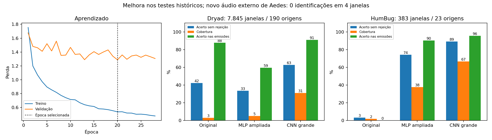

# CNN grande para classificação acústica de mosquitos

A CNN de **3.325.397 parâmetros** melhorou os testes reservados dos dois corpora, mas **ainda não é confiável para identificação em gravações externas**. O novo Aedes aegypti pesquisado depois do treinamento não foi reconhecido. O enxame privado informado pelo usuário como Aedes recebeu 10 identificações de Anopheles gambiae. Pesos e limiares permaneceram congelados durante todos esses testes.

## Modelo e treinamento

Modelo de computador: quatro blocos convolucionais residuais, canais 32/64/128/256, camada de 512 unidades e duas saídas: 20 espécies e presença de mosquito. Cada janela tem 15.872 amostras a 16 kHz (0,992 s). A entrada combina log-mel e contraste espectral local: FFT 2.048, hop 256, 128 bandas de 80–4.000 Hz. Normalização RMS por janela e remoção de média fazem parte do frontend, em todos os corpora e arquivos externos.

Treinamento na GPU AMD Radeon RX 9070 XT com PyTorch/ROCm; lote 96, AdamW, suavização de rótulos, dropout e parada após oito épocas sem melhora na perda de validação. Foram executadas 28 épocas; selecionada a **época 20**, com acerto de validação de 64,6%. Tempo registrado até congelamento: 413.3 s. Mistura de ruído do treino com SNR 5–30 dB, pequenas máscaras temporais/espectrais, variação de inclinação espectral e mistura de sons da mesma espécie ocorreram apenas no treino. Não houve deslocamento de pitch. A mistura sintética não demonstra desempenho em enxames reais.

Dados: 24.405 janelas anteriores mais 8.742 janelas de 307 trechos HumBugDB, representando 214 gravações originais adicionais. O treino usou 14.823 janelas com qualidade válida. Gravação de origem permanece em uma única partição, evitando divisão de trechos irmãos entre treino e teste. As quatro partições e sua atribuição são as mesmas da rodada ampliada; os 307 arquivos foram novamente conferidos por SHA-256. O corpus adicional é concentrado em algumas espécies, não traz cobertura equivalente para todas as 20.

A validação escolheu a época. Uma partição distinta calibrou temperatura (1.195), presença e limiares: presença 0.505; espécie 0.545. A seleção dos limiares usa pesos que equilibram espécie, domínio e origem. As métricas abaixo são contagens de janelas do teste, sem esses pesos. Identificação exige concordância causal em 2/3 janelas e uma janela atual aceita; início, lacunas e áudio inválido reiniciam o histórico. Esses escores não são uma garantia da probabilidade de acerto em campo.

## Comparação nas mesmas partições reservadas

Acerto sem rejeição força uma das 20 classes. Acerto balanceado é a média do recall das classes presentes. Cobertura é a fração de janelas conhecidas com identificação emitida. Acerto nas emissões é calculado somente entre essas janelas, excluindo rejeições. O mesmo algoritmo temporal é aplicado aos três modelos; cada versão conserva sua própria calibração.

| Corpus | Modelo | Acerto sem rejeição | Acerto balanceado | Cobertura | Acerto nas emissões |
|---|---|---:|---:|---:|---:|
| dryad | baseline | 42.2% | 54.0% | 2.9% | 87.9% |
| humbug | baseline | 3.1% | 3.0% | 1.8% | 0.0% |
| dryad | expanded | 33.5% | 47.8% | 4.9% | 59.4% |
| humbug | expanded | 74.2% | 57.6% | 37.6% | 90.3% |
| dryad | large_cnn | 62.7% | 66.8% | 31.0% | 91.1% |
| humbug | large_cnn | 89.0% | 68.7% | 66.6% | 95.7% |

Dryad: 7.845 janelas de espécies conhecidas, 190 origens, 20 classes. HumBug: 383 janelas, 23 origens, **quatro classes**, não 20. Na CNN, foram emitidas 2.431 identificações em Dryad (91,1% corretas) e 255 em HumBug (95,7% corretas). A fração de todas as janelas corretamente identificadas, contando abstenções como não identificadas, foi 28,2% e 63,7%, respectivamente.

As janelas de uma gravação são correlacionadas; esses números não equivalem a milhares de mosquitos independentes. Os testes históricos já tinham sido examinados nas versões anteriores; esta comparação é exploratória e motivou a escolha da CNN. Não demonstra superioridade aos artigos: protocolos, classes e origens de gravação diferem. Uma validação independente ainda é necessária.

### Resultados por espécie no HumBug

| Espécie | Janelas / origens | Recall sem rejeição | Cobertura | Acerto nas emissões |
|---|---:|---:|---:|---:|
| Aedes aegypti | 154 / 7 | 98.1% | 83.1% | 100.0% |
| Anopheles arabiensis | 130 / 8 | 80.0% | 43.1% | 94.6% |
| Anopheles dirus | 89 / 8 | 96.6% | 70.8% | 100.0% |
| Anopheles minimus | 10 / 1 | 0.0% | 80.0% | 0.0% |

Anopheles minimus teve **0/10 acertos**, com oito emissões incorretas em uma única origem. A média global esconde essa falha. No Dryad, o acerto das emissões de Anopheles minimus foi 55,5%; de Culex quinquefasciatus, 63,0%. As demais classes e denominadores estão em [per_class.csv](../results/large_cnn/per_class.csv).

### Ruído e espécies desconhecidas

Não houve identificação de espécie nas 56 janelas de ruído Dryad nem nas 915 HumBug. Houve indicação de presença acima do limiar em 16,1% e 0,2% dessas janelas; presença e identificação são tarefas diferentes. Zero emissões observadas não garante ausência de falsos alarmes no ambiente real.

Das 212 janelas HumBug com rótulo de mosquito não resolvido para uma das 20 classes, **74 (34,9%)** receberam uma espécie. Há 96 janelas sem espécie anotada e 63 de complexo taxonômico; elas não permitem afirmar erro individual. Complexos podem incluir uma das classes conhecidas. Porém, considerando somente táxons específicos fora das 20 classes, houve **26 emissões em 53 janelas**: a rejeição de espécies desconhecidas continua insuficiente. [Detalhamento por táxon](../results/large_cnn/unresolved_taxa.csv).

## Áudio inédito pesquisado depois do congelamento

Fonte primária: [MosquitoSong+ e seus dados](https://github.com/akaraspt/mosquitosongp). Escolhido o macho Aedes aegypti `1M_5D_25C_SmallCylinder`, excluindo todos os cortes e o microfone alternativo da fêmea `1F_5D_25C` já examinada. São indivíduos distintos segundo os metadados. O conjunto externo é o mesmo da rodada anterior, mas esta gravação e seu indivíduo não tinham sido avaliados e nenhum arquivo MosquitoSong+ entrou no treinamento.

Regra definida antes da inferência: primeiro corte em ordem natural com duração ≥2,976 s. Os cortes 1–9 eram curtos; o corte 10 foi selecionado somente pela duração, **não pelo resultado do modelo**. Arquivo de 4,193 s, mono, 8 kHz, convertido para 16 kHz. Foram analisadas quatro janelas completas (3,968 s); cauda 0,225 s não processada. Sem repetição, preenchimento ou filtro de ruído adicional.

- [Arquivo dos autores](https://drive.google.com/file/d/1Vdwz2tPw63ZXNiZMVQASbGSyoMStkrz4/view).
- Seleção: `2026-09-30T21:54:59.228428+00:00`; congelamento: `2026-09-30T21:52:55.578828+00:00`.
- SHA-256 do áudio: `24a5b5f19f1784cc18b7e4bf0e4c9a15a1a3084b52450283a0c318e21ec39295`.
- Resultado CNN: **0/4 janelas com Aedes como primeira classe**; três INCERTO e uma SEM_EVIDENCIA; nenhuma identificação emitida.
- Original e MLP ampliada: também 0/4 Aedes e nenhuma identificação. A CNN detectou candidatos de presença em três janelas, mas não resolveu a espécie.

Esse teste falhou. É uma gravação curta de um indivíduo, não uma estimativa percentual da acurácia geral. O rótulo vem dos autores do dataset, sem nova verificação entomológica nossa. Pesos, frontend e limiares não foram alterados após observar o resultado. [Seleção e auditoria](../results/large_cnn/fresh_external/selection.json) · [Resultados](../results/large_cnn/fresh_external/analysis.json).

## Testes retrospectivos e áudio privado

A fêmea MosquitoSong+ já testada anteriormente continuou sem identificação: cinco janelas INCERTO, 0/5 Aedes como primeira classe. É um desafio retrospectivo fora do treino, **não o teste inédito deste ciclo**.

No áudio privado de 106,24 s, informado pelo usuário como enxame de Aedes aegypti, houve 107 janelas: 89 SEM_EVIDENCIA, seis INCERTO, duas AUDIO_INVALIDO e **10 identificações de Anopheles gambiae**. Nenhuma identificação de Aedes. Sob a referência fornecida pelo usuário, as 10 emissões são incorretas; não há confirmação entomológica independente nem anotação de eventos por instante. O áudio permanece privado e fora do treinamento. Não ouvimos subjetivamente o arquivo nesta sessão; esta análise é computacional.

## Decisão e uso

**Avaliação offline, sem liberação para Arduino.** A melhoria dentro dos corpora é real nesta comparação, mas a generalização ao MosquitoSong+ e ao enxame continua falhando. Não basta aumentar o número de parâmetros. Novas rodadas precisam de diversidade de microfones, sexo, temperatura, ambiente e enxames com identidade documentada; separação também por aparelho/campanha; avaliação independente de espécies fora do vocabulário. A identificação de todas as 20 classes com um único número de acurácia seria enganosa.

Por instrução do usuário, qualquer estratégia de redução, adaptação, compilação ou empacotamento para Arduino aguarda autorização posterior explícita. Nenhum firmware, header exportado, instalador ou binário foi atualizado nesta rodada. Não houve teste em placa física, publicação ou execução de CI. O instalador já publicado permanece da versão anterior.

Reprodução do treinamento: `.venv/bin/python train_large_cnn.py` (sobrescreve a rodada local; após treinar é obrigatório buscar outro áudio inédito). Inferência: `.venv/bin/python test_large_audio.py arquivo.wav --species 'Aedes aegypti' --source URL --output pasta`.

Pesos locais: `results/large_cnn/models/large_cnn.pt`, ignorados pelo Git, SHA-256 `05905636b9b9ae729b87ec365e4812cea44f9834c0e4c258d198ac1871777a9e`. [Protocolo](../results/large_cnn/protocol.json) · [Auditoria](../results/large_cnn/training_audit.json) · [Decisão](../results/large_cnn/reliability_decision.json) · [Notebook](../mosquito_wingbeat_estudo.ipynb).
