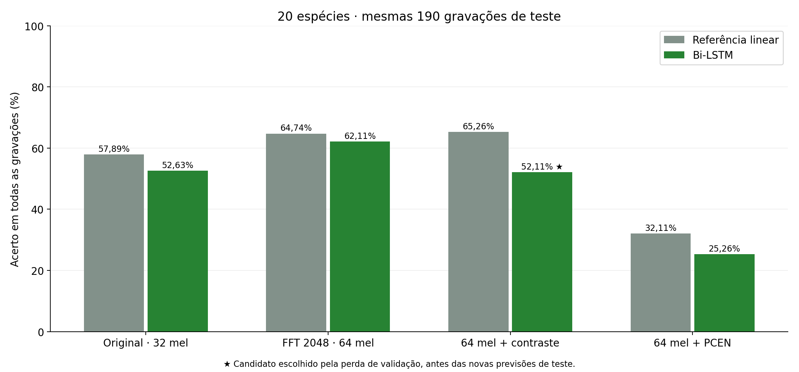
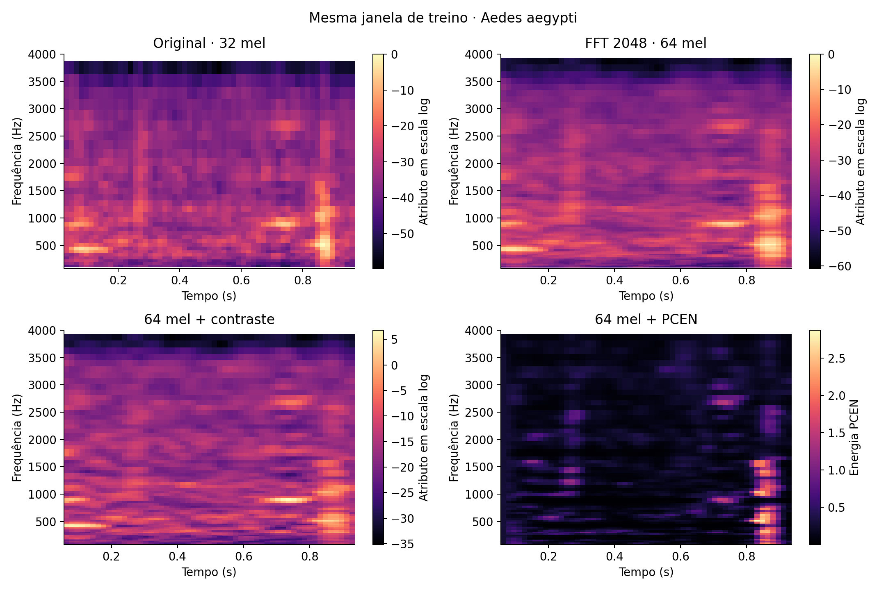
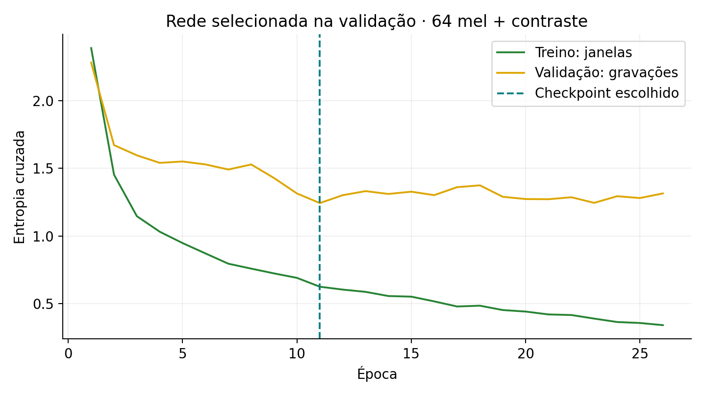

# Pré-processamento das 20 espécies: comparação medida

**Luiz Eduardo do Nascimento Ciarallo** · 15/10/2026

Foram treinadas três novas Bi-LSTMs e três referências lineares, aplicando cada frontend em treino, validação e teste. A rodada anterior foi reexecutada com seus pesos congelados para confirmar a comparação nas mesmas 190 gravações.

## Resultado principal

Na família linear, o frontend escolhido pela menor perda de validação foi **hires_contrast**: **124/190 (65,26%)**, contra **110/190 (57,89%)** anteriormente. Ganho de **+7,37 pontos percentuais**.

A rede selecionada somente pela validação foi **hires_contrast_bilstm**: **99/190 (52,11%)**, contra **100/190 (52,63%)** da Bi-LSTM anterior. Diferença: **-0,53 pontos percentuais**.

Entre todas as famílias, o menor log loss de validação selecionou **hires_contrast_bilstm**, com **99/190 (52,11%)** no teste. A tabela mantém todos os candidatos; o teste não foi usado para mudar essa escolha.

| Pré-processamento | Modelo | Perda de validação | Acertos/190 | Acerto | F1 macro |
|---|---|---:|---:|---:|---:|
| Original · 32 mel | linear | 1.5294 | 110 | 57,89% | 62,48% |
| Original · 32 mel | bilstm | 1.5586 | 100 | 52,63% | 60,78% |
| FFT 2048 · 64 mel | linear | 1.3242 | 123 | 64,74% | 70,80% |
| FFT 2048 · 64 mel | bilstm | 1.2849 | 118 | 62,11% | 72,00% |
| 64 mel + contraste | linear | 1.2809 | 124 | 65,26% | 71,40% |
| 64 mel + contraste | bilstm | 1.2435 | 99 | 52,11% | 65,22% |
| 64 mel + PCEN | linear | 2.3147 | 61 | 32,11% | 35,15% |
| 64 mel + PCEN | bilstm | 2.3411 | 48 | 25,26% | 28,25% |

O candidato Bi-LSTM com FFT 2.048 e 64 bandas, sem compensação adicional, obteve 118/190 acertos (62,11%) e F1 macro de 72,00%, contra 60,78% de F1 macro anteriormente. A tabela permite comparar esse candidato com a escolha de validação. Os resultados observados no teste não foram usados para trocar o modelo escolhido.

## O que mudou no sinal

| Componente | Rodada anterior | Novos candidatos |
|---|---|---|
| Áudio | Mono, 16 kHz, 0,992 s | Igual |
| FFT / janela Hann | 1.024 pontos / 64 ms | 2.048 pontos / 128 ms |
| Espaçamento entre bins | 15,625 Hz | 7,8125 Hz |
| Salto temporal | 256 amostras / 16 ms | Igual |
| Mel | 32 bandas de 80 a 4.000 Hz | 64 bandas na mesma faixa |
| Entrada da rede | 59 passos × 32 bandas | 55 passos × 64 bandas |

- **Maior resolução:** amplia a representação dos tons e dos harmônicos sem deslocar suas frequências.
- **Contraste:** subtrai metade da envoltória local, calculada em nove bandas vizinhas. Compensa parte da coloração espectral sem estimar um perfil de ruído por espécie.
- **PCEN:** controle de ganho por banda, suavização temporal de 0,4 s, alpha 0,98, delta 2, expoente 0,5 e epsilon 10⁻⁶. O estado começa no primeiro frame de cada janela e não atravessa gravações.
- **Normalização:** remoção de média e RMS por janela; média/desvio por banda ajustados só no treino, com piso de desvio 0,001.

As novas redes mantêm duas camadas de 256 unidades, dropout 0,20, Adam 0,0003, lote 128, clipping 3, máximo de 80 épocas e paciência 15. A camada de entrada recebe 64 atributos, portanto o número de parâmetros também muda em relação ao modelo anterior de 32 bandas. Todos os candidatos novos usam a mesma arquitetura de 64 entradas.

## Isolamento e seleção

As partições são cópias exatas das partições auditadas da rodada Torres: 209 gravações de treino, 59 de validação e 190 de teste, estas distribuídas em 174 blocos PCM. O mesmo bloco não atravessa as três partições. A ponderação equilibra classes e gravações; MosquitoSong permanece fora do treino.

`freeze.json` registra a escolha de frontend/modelo antes das novas predições de teste. Os pesos, scalers, caches e scripts executados têm hashes verificados. A reexecução da referência recuperou as mesmas matrizes de confusão da rodada anterior.

## Erros pareados por gravação

Cada linha compara com o modelo da mesma família na representação original.

| Candidato | Erros anteriores corrigidos | Novos erros introduzidos |
|---|---:|---:|
| hires_logmel_linear | 22 | 9 |
| hires_logmel_bilstm | 26 | 8 |
| hires_contrast_linear | 28 | 14 |
| hires_contrast_bilstm | 26 | 27 |
| hires_pcen_linear | 8 | 57 |
| hires_pcen_bilstm | 12 | 64 |

`paired_comparisons.json` também contém intervalos exploratórios por bootstrap de 2.000 reamostragens dos 174 blocos PCM, preservando a relação entre gravações do mesmo bloco.

## Monte Carlo dropout da rede escolhida

Com 100 passagens e exigência de unanimidade (UC = 0), a rede aceita **166/190** gravações (**87,37% de cobertura**), com **94 acertos entre as aceitas** (**56,63% de acerto condicional**). A tabela principal usa todas as gravações, sem excluir as incertas.

## Gráficos







A janela dos espectrogramas é a primeira janela de treino na ordem dos metadados; sua seleção não dependeu da previsão.

## Executar e conferir

```bash
.venv/bin/python evaluate_species_preprocessing.py --output results/nova_rodada_preprocessamento
.venv/bin/python evaluate_species_preprocessing.py --verify-only results/nova_rodada_preprocessamento
.venv/bin/python report_species_preprocessing.py results/nova_rodada_preprocessamento
.venv/bin/python -m pytest -q
```

O executor preserva diretórios existentes e usa os dados/cache e a rodada Torres como referências de entrada.

Inferência da rede escolhida com o frontend correspondente:

```bash
.venv/bin/python predict_torres_2025.py results/species_preprocessing_2026_10_15/hires_contrast --model bilstm --audio caminho/gravacao.wav
```

Inferência da referência linear escolhida na validação, com o mesmo frontend:

```bash
.venv/bin/python predict_torres_2025.py results/species_preprocessing_2026_10_15/hires_contrast --model linear --audio caminho/gravacao.wav
```

Validação de software: **308 testes aprovados**, incluindo os 10 novos contratos de pré-processamento. `verification.json` valida os oito candidatos, o isolamento, a normalização ajustada no treino e os artefatos congelados.

O README histórico protegido pelos manifests foi preservado. As novas entradas de documentação estão em `README_TORRES_2025.md`.

## Referências técnicas

- Mukundarajan et al.: frequência fundamental e harmônicos do voo. https://elifesciences.org/articles/27854
- Wang et al.: PCEN e compressão dinâmica por banda. https://research.google/pubs/trainable-frontend-for-robust-and-far-field-keyword-spotting/

## Limitações e interpretação

- Este é o teste histórico já examinado em outras rodadas, com gravações relacionadas dentro do próprio teste; a comparação é retrospectiva.
- A comparação original versus novos frontends altera FFT, número de bandas e dimensão de entrada. A comparação entre os três candidatos novos mantém essas três escolhas e muda apenas a representação de energia.
- PCEN e contraste podem atenuar componentes informativos; o ganho precisa ser medido e não decorre automaticamente de um áudio parecer mais limpo.
- A tarefa força uma das 20 espécies de mosquito e não mede falsos alarmes em ruído. A detecção de presença/ternária mantém sua avaliação própria.
- Concordância do dropout indica estabilidade da rede e não garante correção.
