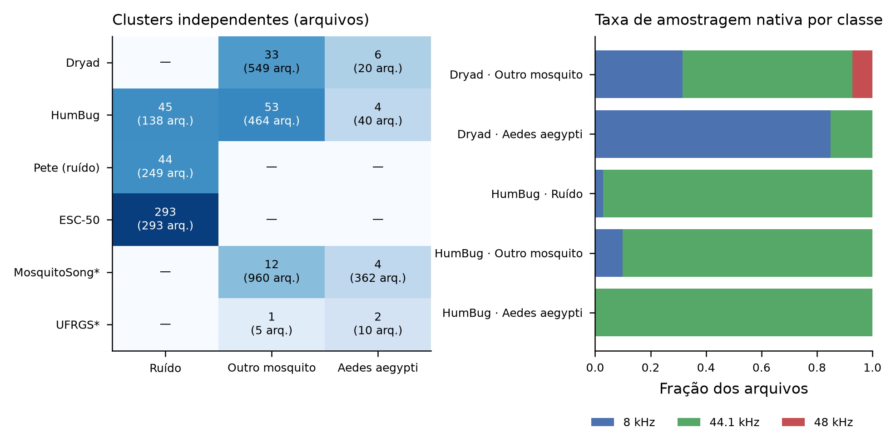
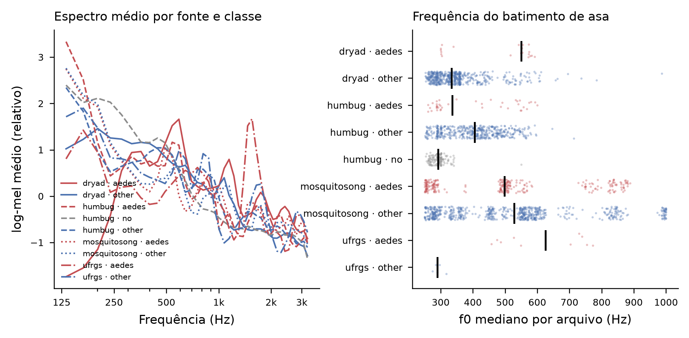
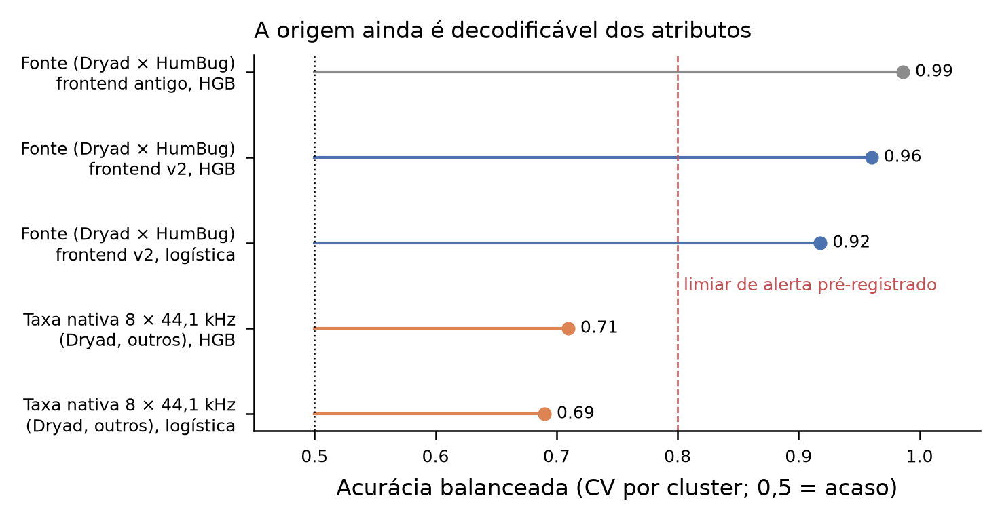
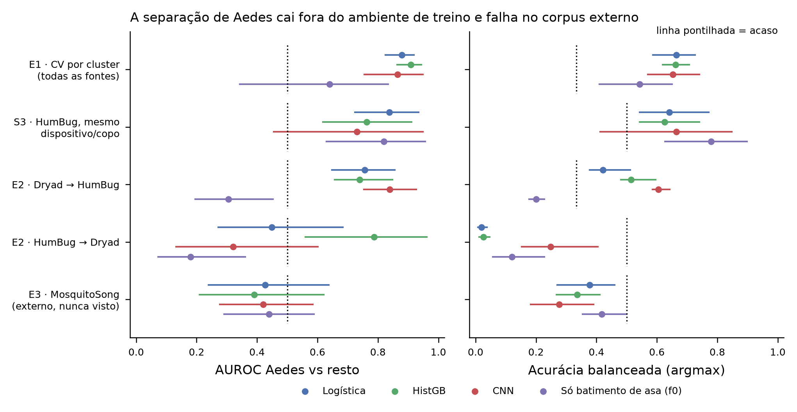
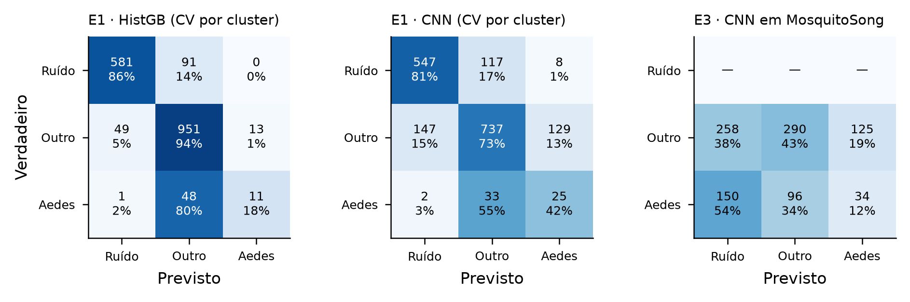

# Reanálise v2 do detector acústico de *Aedes aegypti*

Branch `reanalise-v2`, 20/10/2026. O protocolo foi pré-registrado e congelado por SHA-256 (`reanalysis/protocol_v2.json`, `reanalysis/protocol_freeze.json`). Os desvios estão em `reanalysis/protocol_amendments.md`. O código está em `reanalysis/` (`build_manifest.py`, `frontend.py`, `train_v2.py`, `stress_v2.py`) e os testes em `tests/test_reanalysis_v2.py`.

## 1. Por que refazer
A auditoria do commit `3d5a1b8` encontrou três problemas:
- **Atalho de fonte.** Com uma fonte inteira fora do treino, a detecção de Aedes caía de 75–100% para 0–12%.
- **Rótulo igual à fonte.** O Torres é 100% Aedes e chega como tensores pré-calculados. O ESC-50 é 100% ruído.
- **Dobras por arquivo, não por sessão.** 81 de 110 sessões Dryad cruzavam dobras.

Os números antigos (89–90% de acurácia, 98% de Aedes) não medem generalização.

## 2. Dados e unidade de independência


Desenvolvimento: Dryad/Abuzz, HumBug, ESC-50 (sem a classe *insects*) e o ruído Pete. Externos, nunca usados para ajuste ou seleção: MosquitoSong e UFRGS. Excluídos com motivo registrado: Torres (sem áudio bruto, 100% Aedes), Figshare (não é microfone acústico), espécie desconhecida e o áudio privado do Drive.

Cluster é laboratório+aparelho no Dryad, local+aparelho+setup+dia no HumBug, clip original no ESC-50 e indivíduo no MosquitoSong. **Há apenas 10 clusters independentes de Aedes no desenvolvimento** (6 Dryad e 4 dias HumBug), e não 360.

Confusões detectadas antes de treinar:
- 17 de 20 Aedes do Dryad estão a 8 kHz, contra ~31% das outras espécies.
- O "ruído" do Dryad é um corpus genérico (Pete_dataset), e não o fundo das gravações.
- Todos os Aedes do HumBug vêm de um único setup (Tanzânia/Ifakara/tascam/copo).

## 3. Frontend comum
Decodificação, mono, 8 kHz e passa-banda de 100–3.400 Hz. Janelas de 1 s com a mesma regra de validade para todas as classes, no máximo 30 por arquivo, e ganho RMS unitário. Representação log-mel 40×59 mais 80 estatísticas e 9 descritores do batimento de asa. Foram 30.551 janelas, sem erros de decodificação.



## 4. Diagnóstico de atalhos (antes do treino)


A fonte (Dryad × HumBug) continua decodificável pelos atributos v2: acurácia balanceada **0,96** com HistGB, contra 0,99 no frontend antigo. Isso dispara o alerta pré-registrado (> 0,8). As fontes também diferem em composição de espécies, então parte desse sinal é biológica. A taxa nativa (8 × 44,1 kHz) é decodificável a 0,71.

## 5. Resultados (nível de arquivo, IC95% por bootstrap de cluster com 2.000 réplicas)


| Avaliação | Arquivos/clusters | Logística | HistGB | CNN | Só f0 |
|---|---|---|---|---|---|
| **E1** CV por cluster, AUROC Aedes | 1.745 / 424 | 0,88 [0,82–0,92] | 0,91 [0,86–0,94] | 0,86 [0,76–0,95] | 0,64 [0,34–0,83] |
| E1 acurácia balanceada (acaso 0,33) | | 0,66 [0,59–0,73] | 0,66 [0,62–0,71] | 0,65 [0,57–0,74] | 0,54 [0,41–0,65] |
| E1 detecção / precisão Aedes | | 53% / 14% | 18% / 46% | 42% / 15% | 52% / 7% |
| **E2** Dryad→HumBug, AUROC | 642 / 55 | 0,76 [0,65–0,86] | 0,74 [0,66–0,85] | 0,84 [0,75–0,93] | 0,31 [0,19–0,45] |
| **E2** HumBug→Dryad, AUROC | 569 / 35 | 0,45 [0,27–0,68] | 0,79 [0,56–0,96] | 0,32 [0,13–0,60] | 0,18 [0,07–0,36] |
| E2 HumBug→Dryad, acurácia balanceada (acaso 0,50) | | 0,02 | 0,03 | 0,25 | 0,12 |
| **E3** MosquitoSong, AUROC | 953 / 16 | 0,43 [0,24–0,64] | 0,39 [0,21–0,62] | 0,42 [0,28–0,58] | 0,44 [0,29–0,59] |
| S2 sem ruído externo, AUROC | 1.211 / 90 | 0,85 [0,77–0,91] | 0,88 [0,82–0,93] | 0,89 [0,82–0,94] | 0,60 [0,36–0,78] |
| S3 HumBug, mesmo setup, AUROC | 407 / 42 | 0,84 [0,72–0,94] | 0,76 [0,62–0,91] | 0,73 [0,46–0,95] | 0,82 [0,63–0,96] |
| S3 acurácia balanceada (acaso 0,50) | | 0,64 [0,54–0,77] | 0,63 [0,54–0,74] | 0,66 [0,41–0,85] | 0,78 [0,63–0,90] |



**UFRGS** (15 arquivos, contagens descritivas): CNN, HistGB e logística detectaram **0/10** Aedes. O modelo só-f0 detectou 4/10, com 1/5 falso alarme.

**Leitura dos resultados**
- **Dentro das fontes (E1, S2)** há separação real por ranking: AUROC de 0,86–0,91, cerca de 0,4 acima da classe majoritária no bootstrap pareado. No limiar argmax, porém, a precisão para Aedes é baixa: a maioria dos alertas é falsa.
- **Entre corpora (E2)** a transferência é assimétrica.
  - Dryad→HumBug mantém algum ranking (AUROC 0,74–0,84), mas quase não detecta Aedes no argmax.
  - HumBug→Dryad chama a maioria dos mosquitos do Dryad de "sem mosquito" (acurácia balanceada ≤ 0,25).
- **No corpus externo (E3)** todos os modelos ficam no acaso ou abaixo dele. A CNN chama 54% dos Aedes do MosquitoSong de ruído.
- **No mesmo setup (S3)**, o modelo que usa só o batimento de asa é o melhor (acurácia balanceada 0,78). Há sinal fisiológico, mas ele não sobrevive à troca de aparelho e ambiente.

**Critério pré-registrado** (IC inferior > acaso para AUROC e para acurácia balanceada, em E1 **e** E2): **não é cumprido** por nenhum modelo nas duas direções de E2.

**Caveat de AUROC agregada entre dobras.** Na avaliação dentro do Dryad, a classe majoritária obtém AUROC 0,81 só porque o prior muda entre dobras. AUROC de subconjuntos agregados entre dobras deve ser lida contra essa linha de base.

## 6. Análises exploratórias (emenda A2, motivada por Paim et al., arXiv 2306.10091)
- **S4, sons sintéticos enganosos** (13 tons puros, 13 tons harmônicos de 300–900 Hz, zumbido elétrico e ruído rosa/branco). A logística chama **12/26 tons de Aedes**. A HistGB chama 8/13 tons harmônicos de "outro mosquito". A CNN chama todos de "sem mosquito". Nenhum modelo é robusto e coerente ao mesmo tempo: o que rejeita tons é o mesmo que falha nos Aedes reais externos.
- **D1, oclusão de bandas.** Ocultar a faixa de **130–280 Hz** derruba p(Aedes) nas janelas de Aedes em 0,28 (logística), 0,41 (HistGB) e **0,63 (CNN)**. Ocultar bandas do batimento de asa (316–1.075 Hz) derruba 0,04–0,21. Os modelos dependem principalmente de uma faixa abaixo da frequência de asa do Aedes, compatível com a assinatura de aparelho/codec vista no espectro médio do Dryad.
- O artigo da UFRGS usa 10 dobras aleatórias sobre segmentos com 50% de sobreposição, o que gera vazamento. Suas acurácias não são comparáveis às daqui. A planilha dos autores mostra que o conjunto completo tem 1.109 gravações (104 de *Ae. albopictus*), mas só 15 são públicas.

## 7. Conclusão
Com o protocolo corrigido, **não há evidência confiável** de que algum modelo reconheça *Ae. aegypti* em gravações de ambientes, aparelhos ou corpora não vistos. O desempenho dentro das fontes existe, mas é modesto no limiar operacional e se apoia em pistas espectrais de aparelho. Os resultados anteriores devem ser tratados como superados.

## 8. O que é preciso para validar
1. Novas gravações de Aedes **e** de outras espécies com o mesmo aparelho, mesmo setup e mesmo dia (controles pareados), em vários aparelhos e locais. Exemplo: pedir o conjunto completo da UFRGS, que tem Aedes e albopictus em copo descartável com recipientes identificados.
2. Ruído de fundo **in situ** gravado nos mesmos ambientes, em vez de ESC-50/Pete.
3. Normalizar a resposta do aparelho (equalização por fundo, descarte de <250 Hz) e testar se o desempenho entre fontes melhora. Isso precisa de nova emenda pré-registrada antes de ver os resultados.
4. Um teste cego único em uma campanha nova, com o protocolo congelado antes da coleta.

## 9. Reprodução
```
python reanalysis/build_manifest.py
python reanalysis/frontend.py 20
for s in probes E1 E2 E3 S2 S3 report; do python reanalysis/train_v2.py $s 6; done
python -c "from reanalysis import stress_v2; stress_v2.main()"
python -m pytest -q
```
(`KMP_AFFINITY=disabled` com PyTorch do conda-forge.) Saídas leves versionadas em `reanalysis/outputs/`. Os caches ficam em `data/cache/v2/` e `results/v2/`, fora do Git.
