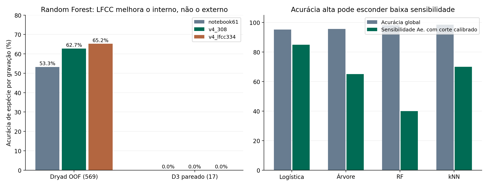

# Reprodução e transferência auditada de Mosquito_v2.ipynb - 14/10/2026

**Não recomendo substituir o pipeline ativo pelo notebook recebido.** A técnica LFCC apresentou um ganho interno modesto no controle com Random Forest, mas não resgatou a espécie externa. O notebook contém vazamento entre gravações, padronização inadequada para CV interna e afirmações de confirmação biológica não sustentadas pela avaliação.

Apliquei as 61 features originais, os quatro classificadores e um bloco de 26 LFCC relativos ao piso espectral em um experimento separado. O Random Forest com features v4 por gravação passou de **62,74% para 65,20%** no Dryad ao acrescentar LFCC. A diferença foi +2,46 p.p., IC95% pareado **[-0.18; +5.10] p.p.**, incluindo zero. Ambas as variantes acertaram **0/17** espécies no D3 pareado. O ensemble v4 histórico, com outro treinamento e MIL, tinha 4/17; os novos classificadores não o substituem.

## Procedência, reprodução e análise de lacunas

Origem: [Mosquito_v2.ipynb fornecido no Drive](https://drive.google.com/file/d/1zl2sr73xdYJar1UH_crFndrEmNWJgA8Q/view). O arquivo tinha 1.438.959 bytes, modificação 14/10/2026 20:24:25 UTC, 31 células e 14 células de código executadas. SHA-256 original: `f0d714aa1e96443a6209ba25e73d145b22875a320e5cdf8c006394cc8e6e2d64`. A cópia original permaneceu intacta em `external/notebook_reference_2026_10_14/`.

O notebook declara 22 arquivos Ae. aegypti e 866 outros, 600 janelas por classe, 840 janelas de treino e 360 de teste. Seus outputs armazenados informam 97,78% para regressão logística, 96,67% para árvore, 98,33% para Random Forest e 83,33% para kNN. No áudio de 106,24 s, declara 103/106 janelas positivas na logística e 99/106 no kNN. **Esses valores são outputs recebidos, não resultados reproduzidos ou validados aqui.** A duração e taxa do áudio coincidem com o cenário conhecido, mas o notebook não registra o hash do WAV, dos dados de treino, dos pesos ou das partições. Não podemos provar igualdade dessas entradas.

As funções de extração foram carregadas por AST, somente as sete definições de features/pré-processamento inspecionadas, sem executar o notebook inteiro ou suas operações de arquivos Windows. A extração de 61 features reproduziu bit a bit os resultados dessas funções para uma janela isolada. O cache do banco de filtros evita reconstruí-lo a cada janela sem alterar os números. O corpo completo de Python foi extraído para inspeção. A repetição literal dos modelos e dos percentuais exige o corpus Windows e sua ordem original, não fornecidos.

| Lacuna do notebook | Evidência | Aplicação feita |
|---|---|---|
| Treino/teste separados por janela | `train_test_split` sem grupo, célula 13 | Mesmos grupos e blocos PCM da v4, fit/calibração/teste disjuntos |
| CV interna recebe scaler já ajustado a todo treino externo | Células 15/17 | `StandardScaler` dentro de `Pipeline` em cada dobra interna |
| Pico de amplitude calculado na gravação inteira | `normalizar_amplitude` antes de segmentar | Pré-processamento confinado à janela de 1 s |
| Filtro descrito como fase zero, mas causal | Célula 6 usa `sosfilt` | Reprodução mantém operação causal e documenta corretamente; LFCC relativo usa STFT v4 |
| 600 primeiras janelas podem concentrar poucos arquivos/aparelhos | Corte na ordem de `glob` e erros silenciados com `except: continue` | Todas as 24.405 janelas auditadas; identificação completa de origem |
| Binário chamado “Não Aedes” inclui outras espécies de Aedes | Alvo é somente Ae. aegypti | Rótulo explícito `other_species_or_noise`; não equivale a ausência de mosquito |
| F0 estimado por um único pico 150-1500 Hz | Célula 8 usa argmax de FFT | Mantido apenas como controle; não substitui SHS/múltiplos harmônicos da v4 |
| Probabilidade/voto chamado confirmação biológica | Células 28/29 | CLI informa `experimental=true` e `biological_confirmation=false` |

Num subconjunto local análogo de 1.200 janelas (primeiras 600 positivas e 600 negativas, usando os metadados locais), existem somente dez grupos positivos e dez negativos. Todos os vinte grupos cruzam a separação aleatória: **360/360 janelas de teste vêm de gravações também presentes no treino**. Esse é um contraexemplo local ao protocolo; não é a auditoria dos CSVs Windows originais. Não treinamos nenhum modelo nessa separação inválida.

A normalização da gravação inteira também é não indutiva por janela: mantendo o primeiro segundo inalterado e aumentando apenas a amplitude do segundo, suas features de RMS, pico e cepstra mudam. O detector atual recebido do Drive já tem dependência de contexto da gravação, documentada na auditoria anterior. Copiar esse comportamento do notebook perpetuaria o problema.

A documentação de [Pipeline e vazamento de pré-processamento](https://scikit-learn.org/stable/common_pitfalls) sustenta colocar o scaler dentro da CV. A documentação de [sosfiltfilt](https://docs.scipy.org/doc/scipy/reference/generated/scipy.signal.sosfiltfilt.html) distingue a filtragem de ida/volta de `sosfilt`. Passa-faixa retira componentes fora da banda, não separa automaticamente mosquito de ruído dentro dela.

## Experimento aplicado

Usamos os 560 blocos PCM auditados, 613 gravações agrupadas, 569 positivas de 20 espécies e 44 grupos de ruído. A matriz PCM cacheada tem 24.405 linhas de 16.000 amostras; ela já deriva do frontend histórico com normalização por janela. O controle recebido aplica adicionalmente seu passa-faixa causal 200-2000 Hz e normalização de pico, dentro da janela. Não alegamos repetição das taxas nativas de celulares usadas no Windows.

Foram comparadas três representações:

1. `notebook61`: nove estatísticas temporais/espectrais e 52 médias/desvios MFCC/LFCC reproduzidos do código recebido; normalização somente dentro de cada janela.
2. `v4_308`: matriz de features v4 congelada, sem alterar seu código ou bytes.
3. `v4_lfcc334`: mesmas 308 features e mais 26 médias/desvios LFCC, usando bancos lineares de 200-3900 Hz, STFT de 100 ms, potência relativa ao piso móvel local, centralização por mediana de frame e C0 zerado. C1/C2 não são apagados.

Todas usam média aritmética das features por gravação, uma linha de treino por grupo de origem. Essa média foi fixada antes da avaliação e é idêntica entre controles; **não substitui nem refuta o MIL por probabilidade da v4**. O resultado ruim fora do domínio pode incluir diluição de trechos de voo e rótulos fracos. A diferença LFCC é uma ablação entre classificadores com a mesma unidade, partições, pooling e grade; a comparação com o ensemble v4 completo é contextual, não uma ablação isolada.

O alvo binário usa os quatro classificadores do notebook, mais controles logísticos com v4/v4+LFCC. A tarefa de 20 espécies usa logística e Random Forest em todas as representações. Existem 12 combinações, três dobras externas e um modelo final por combinação: **48 pipelines**. Temperatura probabilística e limiares de abstenção foram ajustados somente na calibração reservada, sem reentrá-la no fit. O corte de detecção de Ae. aegypti exige FPR de calibração <=5% e piso 0,5; é diferente da classe vencedora por argmax.

Para manter a rodada prática e transparente, a grade não repete o GridSearchCV integral do Windows: logística C=[0,01;0,1;1;10]; árvore profundidade=[3;6;sem limite] e mínimo split=[2;10]; RF árvores=[100;200], profundidade=[6;sem limite]; kNN k=[3;7;15], pesos uniformes/distância. São três dobras internas `StratifiedGroupKFold` por bloco PCM e score macro-F1. Logística/árvores usam balanceamento de classe aprendido no próprio fit; kNN não recebe `sample_weight`. Uma linha por gravação reduz o domínio de arquivos longos, mas não remove atalho de aparelho. Grupos diferentes do mesmo bloco podem ter dependência residual; permanecem juntos nas dobras.

As classes raras têm poucos grupos: alguns fits de espécies possuem somente um ou dois exemplos de um táxon, menos que três folds. Os avisos foram preservados; nem toda dobra interna contém cada espécie em ambos os lados. Isso limita a estabilidade do score e dos hiperparâmetros. Não afirmamos validação robusta de todos os táxons.

Congelamento: **2026-10-14T20:39:44.260795+00:00**, SHA-256 `a0eeecf176315b8d6d8dd122494e7051f07283d22b65429b978d69f13cc4a1c9`. Todas as dobras, modelos finais, scalers, temperaturas, limiares, features e regras estavam congelados antes de gerar previsões OOF/externas. `evaluation_protocol.json` conferiu os hashes das entradas e do notebook original e registrou o CLI. O vencedor final foi escolhido por CV do fit, nunca pelo desempenho externo: binário `notebook61/kNN`, espécies `v4_lfcc334/RF`. Para OOF, a análise também calcula a política de escolha por dobra a partir dos scores internos já congelados; não escolhe o maior resultado OOF.

## Métricas por gravação

Acurácia e Macro-F1 abaixo são de argmax. Cobertura e acerto aceito usam o limiar de abstenção por tarefa. A última coluna é acerto em Ae. aegypti por argmax; nos modelos binários isso não é necessariamente a sensibilidade no corte FPR. `drive` tem apenas um rótulo fornecido pelo usuário; porcentagens triviais não são uma estimativa de generalização. Não há denominador temporal anotado.

| Base | Tarefa | Features | Modelo | Acurácia | Balanceada | F1 união estrita | Cobertura | Acerto aceito | Ae. aegypti |
|---|---|---|---|---:|---:|---:|---:|---:|---:|
| dryad | binary | notebook61 | lr | 95.27% | 95.14% | 77.11% | 99.18% | 95.56% | 19/20 |
| dryad | binary | notebook61 | tree | 95.60% | 80.81% | 73.38% | 100.00% | 95.60% | 13/20 |
| dryad | binary | notebook61 | rf | 98.04% | 70.00% | 78.07% | 98.04% | 98.34% | 8/20 |
| dryad | binary | notebook61 | knn | 98.53% | 84.75% | 87.46% | 97.88% | 98.83% | 14/20 |
| dryad | binary | v4_308 | lr | 96.74% | 98.31% | 82.48% | 99.84% | 96.73% | 20/20 |
| dryad | binary | v4_lfcc334 | lr | 96.74% | 98.31% | 82.48% | 99.84% | 96.73% | 20/20 |
| dryad | species | notebook61 | lr | 55.01% | 66.96% | 63.58% | 0.00% | não definido | 13/20 |
| dryad | species | notebook61 | rf | 53.25% | 56.71% | 58.71% | 27.24% | 76.13% | 16/20 |
| dryad | species | v4_308 | lr | 56.59% | 61.51% | 58.17% | 0.00% | não definido | 17/20 |
| dryad | species | v4_308 | rf | 62.74% | 58.66% | 60.67% | 41.30% | 86.81% | 18/20 |
| dryad | species | v4_lfcc334 | lr | 55.89% | 60.71% | 57.58% | 0.00% | não definido | 18/20 |
| dryad | species | v4_lfcc334 | rf | 65.20% | 62.36% | 63.35% | 39.89% | 87.22% | 20/20 |
| external17 | binary | notebook61 | lr | 64.71% | 68.27% | 61.36% | 100.00% | 64.71% | 3/4 |
| external17 | binary | notebook61 | tree | 76.47% | 50.00% | 43.33% | 100.00% | 76.47% | 0/4 |
| external17 | binary | notebook61 | rf | 76.47% | 50.00% | 43.33% | 100.00% | 76.47% | 0/4 |
| external17 | binary | notebook61 | knn | 70.59% | 46.15% | 41.38% | 100.00% | 70.59% | 0/4 |
| external17 | binary | v4_308 | lr | 64.71% | 42.31% | 39.29% | 100.00% | 64.71% | 0/4 |
| external17 | binary | v4_lfcc334 | lr | 64.71% | 42.31% | 39.29% | 100.00% | 64.71% | 0/4 |
| external17 | species | notebook61 | lr | 11.76% | 10.00% | 7.62% | 70.59% | 8.33% | 0/4 |
| external17 | species | notebook61 | rf | 0.00% | 0.00% | 0.00% | 5.88% | 0.00% | 0/4 |
| external17 | species | v4_308 | lr | 5.88% | 5.00% | 2.22% | 0.00% | não definido | 0/4 |
| external17 | species | v4_308 | rf | 0.00% | 0.00% | 0.00% | 58.82% | 0.00% | 0/4 |
| external17 | species | v4_lfcc334 | lr | 11.76% | 10.00% | 5.05% | 0.00% | não definido | 0/4 |
| external17 | species | v4_lfcc334 | rf | 0.00% | 0.00% | 0.00% | 29.41% | 0.00% | 0/4 |
| drive | binary | notebook61 | lr | 0.00% | 0.00% | 0.00% | 100.00% | 0.00% | 0/1 |
| drive | binary | notebook61 | tree | 0.00% | 0.00% | 0.00% | 100.00% | 0.00% | 0/1 |
| drive | binary | notebook61 | rf | 0.00% | 0.00% | 0.00% | 100.00% | 0.00% | 0/1 |
| drive | binary | notebook61 | knn | 0.00% | 0.00% | 0.00% | 100.00% | 0.00% | 0/1 |
| drive | binary | v4_308 | lr | 0.00% | 0.00% | 0.00% | 100.00% | 0.00% | 0/1 |
| drive | binary | v4_lfcc334 | lr | 0.00% | 0.00% | 0.00% | 100.00% | 0.00% | 0/1 |
| drive | species | notebook61 | lr | 0.00% | 0.00% | 0.00% | 100.00% | 0.00% | 0/1 |
| drive | species | notebook61 | rf | 0.00% | 0.00% | 0.00% | 0.00% | não definido | 0/1 |
| drive | species | v4_308 | lr | 0.00% | 0.00% | 0.00% | 0.00% | não definido | 0/1 |
| drive | species | v4_308 | rf | 0.00% | 0.00% | 0.00% | 0.00% | não definido | 0/1 |
| drive | species | v4_lfcc334 | lr | 100.00% | 100.00% | 100.00% | 0.00% | não definido | 1/1 |
| drive | species | v4_lfcc334 | rf | 0.00% | 0.00% | 0.00% | 0.00% | não definido | 0/1 |

As tabelas completas incluem também os fresh e pós-freeze anteriores. O Macro-F1 de suporte e o de união estrita são guardados separadamente em `metrics.csv/json`; táxons previstos fora do suporte verdadeiro entram no estrito. O gênero foi analisado apenas como pós-hoc da espécie em `genus_posthoc_metrics.csv`; não foi criado um novo limiar de gênero a partir do teste.

## Corte de detecção calibrado para Ae. aegypti

| Base | Features | Modelo | Sensibilidade | Especificidade | Precisão |
|---|---|---|---:|---:|---:|
| dryad | notebook61 | lr | 85.00% | 96.96% | 48.57% |
| dryad | notebook61 | tree | 65.00% | 96.63% | 39.39% |
| dryad | notebook61 | rf | 40.00% | 100.00% | 100.00% |
| dryad | notebook61 | knn | 70.00% | 99.49% | 82.35% |
| dryad | v4_308 | lr | 50.00% | 98.82% | 58.82% |
| dryad | v4_lfcc334 | lr | 55.00% | 98.82% | 61.11% |
| external17 | notebook61 | lr | 75.00% | 61.54% | 37.50% |
| external17 | notebook61 | tree | 0.00% | 100.00% | não definido |
| external17 | notebook61 | rf | 0.00% | 100.00% | não definido |
| external17 | notebook61 | knn | 0.00% | 100.00% | não definido |
| external17 | v4_308 | lr | 0.00% | 84.62% | 0.00% |
| external17 | v4_lfcc334 | lr | 0.00% | 84.62% | 0.00% |

A logística `notebook61` detecta 3/4 Ae. aegypti no D3, mas também emite cinco falsos positivos entre treze negativos: precisão 37,50%, especificidade 61,54%. Isso não atende o critério científico do projeto, especialmente com amostra pequena. Trocar automaticamente o vencedor do fit por essa logística após observar o D3 seria seleção pelo teste; isso não foi feito.

## Intervalos e LFCC

O controle RF com LFCC aumenta a acurácia Dryad em +2,46 p.p. com intervalo cruzando zero, e Macro-F1 estrito em +2,68 p.p., IC95% [-0,35;+5,74] p.p. A acurácia balanceada sobe +3,70 p.p., IC95% [+0,54;+6,80] p.p.; é um resultado secundário interno, sem correção por múltiplas comparações. Usamos 2.000 reamostragens pareadas por blocos PCM, estratificando conjuntos de rótulos observados, em 569 gravações/517 blocos. Os ICs não corrigem seleção do corpus nem estabelecem independência biológica. O intervalo [0;0] da diferença externa decorre de ambos errarem tudo naquele lote; não é evidência de precisão de espécie.

Em Ae. aegypti interno, esse RF passa de 18/20 para 20/20; nos 17 externos, ambos continuam 0/4. O LR com LFCC gera um candidato Ae. aegypti no arquivo privado, mas seu limiar de espécie rejeita todas as gravações: não é uma identificação aceita. O RF escolhido pela CV gera An. gambiae no áudio privado e se abstém. A alta acurácia binária global pode coexistir com baixa sensibilidade: notebook61/RF tem 98,04% no Dryad, mas apenas 40% de sensibilidade Ae. no corte calibrado.

A importância por impureza do RF escolhido atribui 10.13% da massa ao bloco LFCC adicional. Essa importância vem somente do fit e não prova causalidade, independência de canal ou contribuição exclusiva, pois features correlacionadas repartem importância. O teste sintético 25→12 dB dá cosseno LFCC médio 0,9757; não demonstra invariância exata a ruído, aparelhos ou condições reais.



## Aquisição posterior ao freeze

A fonte oficial [BioDCASE D3 no Zenodo](https://zenodo.org/records/19095788) foi conferida depois do congelamento. A regra determinística escolheu os primeiros dois IDs numéricos Ae. aegypti D3 ainda não existentes no acervo, duração real >=1 s, sem substituição após exclusão por colisão. Foram auditados 7.558 WAVs conhecidos por bytes e fragmentos PCM alinhados, brutos e normalizados por ganho. O índice não detecta todos os deslocamentos arbitrários, ancestrais biológicos ou sessões.

S_1_D_3_89 (30,74325 s) e S_1_D_3_90 (27,538875 s) tiveram zero colisões conhecidas de bytes/PCM e foram aceitos. A seleção ocorreu às 2026-10-14T20:46:47.055888+00:00 e terminou às 2026-10-14T20:47:19.933002+00:00. Os pesos e cortes não foram retocados. O RF com LFCC escolhido para 20 espécies acertou 0/2 e se absteve nos dois; o kNN binário escolhido também não resgatou esses dois positivos. A logística binária do notebook acertou por argmax apenas o 89. Como são apenas dois positivos de um corpus familiar, não medem precisão ou especificidade nem constituem coleta confirmatória nova.

## Melhorias implementadas e próximos pontos do código atual

- `notebook_transfer_features.py`: funções originais carregadas de forma restrita, banco de filtros em cache, frontend 61 estritamente por janela e extensão LFCC relativa sem log de potência truncada em zero.
- `reproduce_notebook_transfer.py`: treinamento e avaliação separados, scalers dentro da CV por PCM, modelos leves alternativos, abstenção, logs e SHA-256 antes da avaliação.
- `predict_notebook_transfer.py`: CLI offline com verificações, seleção por CV interna, rótulo negativo explícito e ausência de “confirmação biológica”.
- `acquire_notebook_transfer_check.py` e `analyze_notebook_transfer.py`: seleção de arquivos novos por procedência e análise pareada, sem ajuste pelos testes.
- Testes novos cobrem reprodução numérica, indução bit a bit, ganho, silêncio/entradas inválidas, grupos, cutoff e scaler restrito ao fit.

Os próximos gargalos merecem uma nova hipótese pré-declarada: eliminar contexto entre janelas do script neural atual; combinar LFCC com MIL/presença sem mexer no frontend neural de pesos antigos; separar/aponderar aparelhos e sessões no treino; testar outra aquisição com negativos difíceis e anotação temporal/entomológica; aumentar grupos de classes raras. Isso é uma agenda, não resultado já atingido. Nenhuma regra de bônus foi ajustada pelo D3 ou pelos dois novos arquivos.

**Não aplicar o passa-faixa e a normalização do notebook diretamente ao PCM da rede neural congelada.** Seus pesos foram aprendidos com o frontend original; o estudo foi treinado separadamente. A inferência ativa, os modelos v1-v4, firmware, instalador e README/MODEL_VALIDATION protegidos permaneceram intactos.

## Reexecutar e inspecionar

O notebook executado `notebooks/reproducao_notebook_mosquito_v2_2026_10_14.ipynb` tem cinco células de código executadas, sem erros, com tabelas e gráfico. O original recebido fica no link fornecido pelo usuário e no caminho local registrado; o pacote de execução exclui áudio privado bruto e não duplica suas saídas de áudio embutido.

```bash
.venv/bin/python predict_notebook_transfer.py --audio data/raw/drive_test/drive_audio.wav --task species
.venv/bin/python predict_notebook_transfer.py --audio data/raw/drive_test/drive_audio.wav --task binary --variant notebook61 --family lr
```

Para repetir treino, use um diretório novo com a API `train(out=ROOT/'results/nova_repeticao', workers=4, jobs=2)`, seguido de `evaluate(out=...)`. O padrão protege a rodada concluída contra sobrescrita. As fases CLI operam sobre a rodada corrente; não execute treino novamente no diretório já concluído.

Os logs dos testes e execução, protocolos, partições, previsões, matrizes e importância estão nos artefatos do experimento. O estado real da suíte e a preservação são registrados na conclusão, sem ocultar a falha já existente da v5. **Decisão: LFCC fica como extensão experimental. Confiabilidade externa não foi atingida; sem liberação para Arduino.**

Conclusão executada: **232 testes aprovados, uma falha pré-existente v5, 12 novos testes aprovados**, 59.933 avisos, 41,54 s. `verify_freeze` v1-v4 e `verify_history` passaram antes e depois, mantendo 1.239 arquivos históricos. O notebook executado teve cinco células de código e zero erros. Nenhuma compilação ou alteração do pipeline ativo foi realizada.
