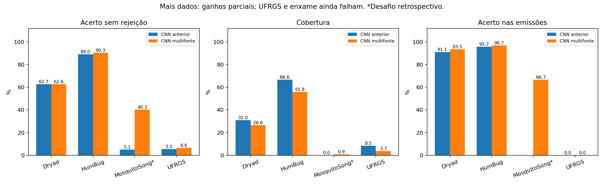

# Retreinamento com múltiplas fontes de áudio

**Execução concluída em 30/09/2026.** Os datasets adicionais foram baixados, auditados e usados em treinamento ou avaliação. A CNN melhorou em algumas tarefas e reduziu identificações erradas, mas **não ficou confiável em novos aparelhos/ambientes**. A UFRGS continua falhando e o enxame privado não foi identificado. Arduino, instalador e binários publicados não foram alterados.

## Dados baixados e uso efetivo

- **Figshare:** 2.988 WAV baixados e extraídos; 1.867 janelas de Aedes e 1.077 de rótulos taxonômicos não resolvidos entraram na adaptação. Culex pipiens & quinquefasciatus e Culiseta não foram inventados como espécies exatas. Todos os arquivos desse corpus ficaram no treino, pois não temos identidade da gravação longa/indivíduo para justificar um teste aleatório de recortes. Variantes e recortes não são indivíduos novos.
- **MosquitoSong:** todos os 1.324 WAV dos autores foram baixados; cortes e canais do mesmo grupo permaneceram juntos. 1.400 janelas foram usadas no treino, 987 na validação e 352 no desafio histórico de Aedes de cinco dias. Aedes de 21 dias é adaptação; as gravações de cinco dias antes examinadas continuam fora do treino. **Não é possível comprovar que os indivíduos de idades diferentes são distintos**: o resultado de MosquitoSong é retrospectivo e não valida transferência para indivíduos desconhecidos. Para as outras três espécies, machos ficaram no treino e fêmeas na validação, mantendo as idades e ambos os microfones do mesmo grupo juntos.
- **UFRGS:** 15 WAV baixados, todos fora do treino/validação/calibração: dez Aedes aegypti (271 janelas) e cinco referências **não-Aedes** (146 janelas). O nome `No_Aedes_aegypti` não identifica outra espécie nem comprova ausência de mosquito. Corrigimos a descrição inicial do catálogo que mencionava albopictus nessa seleção: não há essa pasta no repositório atual.
- **BioDCASE Development:** ZIP completo de 3.799.065.219 bytes baixado; MD5 `dbf35b9066e82cdee5461fca138f4986` conferido. Usado somente como teste auxiliar dos domínios D1–D4. De 4.238 arquivos do teste oficial nesses domínios, 3.893 foram retidos, com 36.963 janelas. Foram removidos 280 arquivos por identidade binária com treino ou duplicação no benchmark, e 65 menores que 0,3 s. A origem/identidade individual não está completamente mapeada; **não é um teste comprovadamente independente dos corpora anteriores**. D5 foi excluído porque a modalidade/origem de sensor não foi confirmada. O conjunto oficial Evaluation, sem rótulos públicos de espécie, não foi usado.
- **Synthetic Swarm:** 315 WAV e rótulos foram baixados. Não entraram na rodada: misturas derivam do Abuzz já usado, sem mapeamento completo dos ancestrais. Inserir uma mistura de origens de teste no treino contaminaria a avaliação. Mantivemos apenas a mistura sintética feita dentro do nosso treino, com fontes do treino.

Ao preparar as fontes adicionais foram detectados 42 arquivos binariamente duplicados e quatro curtos demais. O experimento reuniu 39.247 janelas, preservando todas as partições originais; 6.100 janelas foram adicionadas ao conjunto completo, **4.344 ao treino**. Treino válido total: **19.167 janelas**. [Contagens](../results/multisource/additional_counts.csv) · [Auditoria](../results/multisource/data_audit.json).

Fontes: [Figshare](https://figshare.com/articles/dataset/Mosquitoes_Bioacoustic_Features_-_A_Public_Dataset/11902125), [MosquitoSong](https://github.com/akaraspt/mosquitosongp), [UFRGS](https://github.com/ComputerNetworks-UFRGS/Aedes_Detector_Smartphone_App_Paper), [BioDCASE](https://zenodo.org/records/20478577), [Synthetic Swarm](https://github.com/duydinhthai27/synthetic-swarm-mosquito).

## Treinamento e controle

Mantivemos a CNN residual de **3.325.397 parâmetros** e ajustamos seus pesos a partir da versão grande anterior, sem substituí-la. Os lotes alternam 0,3 s (4.800 amostras reais) e 0,992 s (15.872); janelas longas podem ser cortadas para o lote curto, mas os áudios curtos não são repetidos, concatenados nem preenchidos. O frontend aceita esses comprimentos e usa o mesmo log-mel/contraste e normalização RMS. Isso permite aproveitar o Figshare sem fabricar continuidade acústica.

AdamW com taxa inicial 0,0002, amostragem equilibrando classe/domínio/origem, ruído e sobreposição da mesma espécie provenientes apenas do treino. Foram executadas **10 épocas**, com melhor perda de validação na **época 2**. O ajuste é exploratório; a validação já tinha sido usada na rodada anterior. Calibração ficou na partição antiga separada, com temperatura 0.908, limiar de presença 0.620 e de espécie 0.595. Uma emissão temporal exige pelo menos 2,976 s reais e concordância causal; recortes curtos isolados têm classificação forçada avaliada, sem fabricar identificação temporal.

Pesos e limiares congelados em `2026-09-30T22:33:01.763392+00:00`, SHA-256 `c754c0d48e5ceb43946bc6e3b1b4c3ff44ade2c693becc75be785ee540b43acf`. Nenhum limiar foi ajustado com os testes abaixo. A UFRGS e o áudio privado não entraram no treino. Os nomes de arquivo/rótulos/domínios não são entradas da rede; somente o áudio é processado.

## Comparação pareada

As duas CNNs foram aplicadas às **mesmas janelas**, com o mesmo controle temporal. Cada versão conserva sua própria calibração. Acerto sem rejeição força uma espécie; cobertura é a proporção de janelas com emissão; acerto nas emissões exclui as rejeições. `nan` indica ausência de emissões, não acerto de 0%.

| Corpus | Modelo | Janelas conhecidas | Acerto sem rejeição | Cobertura | Acerto nas emissões |
|---|---|---:|---:|---:|---:|
| dryad | large_cnn | 7845 | 62.7% | 31.0% | 91.1% |
| humbug | large_cnn | 383 | 89.0% | 66.6% | 95.7% |
| mosquitosong | large_cnn | 352 | 5.1% | 0.0% | nan% |
| ufrgs | large_cnn | 271 | 5.5% | 8.5% | 0.0% |
| dryad | multisource_cnn | 7845 | 62.6% | 26.6% | 93.5% |
| humbug | multisource_cnn | 383 | 90.3% | 55.9% | 96.7% |
| mosquitosong | multisource_cnn | 352 | 40.3% | 0.9% | 66.7% |
| ufrgs | multisource_cnn | 271 | 6.6% | 3.7% | 0.0% |

A melhora em HumBug é pequena: 89,0% → 90,3%, enquanto a cobertura cai de 66,6% para 55,9%. No Dryad, o acerto sem rejeição permanece em cerca de 62,6%, com menor cobertura. **Mais precisão nas emissões não significa mais sons identificados.** Anopheles minimus no HumBug ainda tem recall zero em dez janelas de uma origem.

No MosquitoSong, 5,1% → 40,3% de acerto forçado, mas apenas três emissões, duas corretas e uma errada. Na UFRGS, 5,5% → 6,6% forçado; as dez emissões da nova versão são todas incorretas. A comparação não demonstra confiabilidade fora das fontes de treinamento. Nos cinco arquivos negativos da UFRGS, nenhuma versão emitiu Aedes; isso não valida as outras espécies emitidas.

Nas 212 janelas HumBug de mosquito sem rótulo resolvido para as 20 classes, emissões caíram de 34,9% para 11,3%. Não houve emissão de espécie nas 56 janelas de ruído Dryad ou 915 HumBug. Esses resultados amostrais não garantem ausência de falsos alarmes em campo.

### Benchmark BioDCASE auxiliar

| Domínio | Modelo | Janelas | Acerto sem rejeição | Acerto nas emissões |
|---|---|---:|---:|---:|
| biodcase_D1 | large_cnn | 27257 | 36.9% | 58.5% |
| biodcase_D3 | large_cnn | 5997 | 5.7% | 0.0% |
| biodcase_D2 | large_cnn | 1119 | 6.7% | 0.0% |
| biodcase_D4 | large_cnn | 2590 | 46.8% | 82.3% |
| biodcase_D1 | multisource_cnn | 27257 | 45.1% | 80.6% |
| biodcase_D3 | multisource_cnn | 5997 | 8.2% | 0.6% |
| biodcase_D2 | multisource_cnn | 1119 | 10.9% | 2.3% |
| biodcase_D4 | multisource_cnn | 2590 | 50.3% | 92.5% |

Há ganhos nos quatro domínios, mas D2/D3 permanecem muito ruins. Janelas de uma gravação são correlacionadas. Não comparar esses números diretamente com a classificação por clipe do desafio: nosso recorte de duração, exclusões e protocolo temporal diferem. A verificação de duplicatas binárias não garante ausência de recortes irmãos, versões reamostradas ou sobreposição de indivíduos.

## Cinco áudios inéditos após o congelamento

Após concluir o treino, procuramos novamente a fonte pública HumBug e selecionamos, **antes da inferência**, os cinco primeiros IDs de Aedes de grupos distintos, duração ≥2,976 s e ano ≥2018, excluindo todas as origens dos 307 trechos anteriores. Downloads novos passaram em CRC32 e SHA-256. Não houve duplicatas binárias com o treinamento ou os áudios BioDCASE já avaliados; uma comparação das formas de onda reamostradas também não encontrou equivalências completas. Isso não prova ausência de todo recorte deslocado no benchmark. Os cinco são da mesma campanha/país e tipo de microfone presentes no HumBug: **novas gravações, não um domínio inteiramente novo**.

| ID | Modelo | Janelas | Aedes como primeira classe | Emissões corretas | Emissões erradas |
|---|---|---:|---:|---:|---:|
| 220301 | large_cnn | 5 | 5 | 3 | 0 |
| 220301 | multisource_cnn | 5 | 5 | 3 | 0 |
| 220314 | large_cnn | 15 | 15 | 13 | 0 |
| 220314 | multisource_cnn | 15 | 15 | 10 | 0 |
| 220324 | large_cnn | 12 | 12 | 10 | 0 |
| 220324 | multisource_cnn | 12 | 12 | 8 | 0 |
| 220391 | large_cnn | 5 | 5 | 0 | 0 |
| 220391 | multisource_cnn | 5 | 5 | 0 | 0 |
| 220403 | large_cnn | 48 | 47 | 39 | 0 |
| 220403 | multisource_cnn | 48 | 47 | 20 | 0 |

Ambas as versões identificaram Aedes em **quatro de cinco arquivos**. Em 85 janelas, ambas acertaram 84 quando forçadas. Emissões corretas: CNN anterior **65/85**; nova **41/85**, sem emissões erradas em nenhuma versão. A nova ficou mais conservadora; este teste **não demonstra superioridade da nova CNN**. Não tratar 4/5 arquivos como estimativa da acurácia geral, nem 85 janelas como 85 mosquitos.

[Seleção e metadados](../results/multisource/fresh_external/selection.json) · [Resultados pareados](../results/multisource/fresh_external/summary.csv) · [Auditoria de novidade](../results/multisource/fresh_external/novelty_audit.json).

## Seu áudio privado de enxame

A referência de Aedes aegypti é a identificação informada pelo usuário, sem confirmação entomológica independente. Das 107 janelas: 99 SEM_EVIDENCIA, seis INCERTO e duas AUDIO_INVALIDO. Nenhuma identificação foi emitida, contra dez emissões erradas de Anopheles gambiae na CNN anterior. Aedes ficou em primeiro lugar em 46 janelas (antes 22), porém isso **não é identificação aceita**. O áudio permanece privado, fora do treino. Há redução de falsos rótulos, mas o enxame continua sem resolução de espécie.

## Decisão e reprodução

**Manter em avaliação offline.** Não substituir a versão anterior como se estivesse validada: ganhos são parciais, houve queda de cobertura e a generalização à UFRGS continua falhando. Antes de outro treinamento, será preciso definir como usar uma parte da UFRGS para adaptação sem chamar os mesmos arquivos de teste independente, e reservar outra campanha real de celular/microfone com espécie confirmada. Toda gravação usada para orientar novas decisões passa a ser histórica; a próxima rodada exige novamente áudio inédito após congelar pesos.

Scripts: `fetch_additional_audio.py`, `fetch_biodcase.py`, `prepare_multisource.py`, `train_multisource.py`, `prepare_biodcase_benchmark.py`, `evaluate_multisource.py`, `fetch_fresh_multisource_test.py`, `summarize_multisource.py`. O treinamento sobrescreve somente `results/multisource`; modelos anteriores são preservados. Inferência usa `test_large_audio.py --checkpoint results/multisource/models/multisource_cnn.pt ...`. Pesos e datasets ficam locais, ignorados pelo Git.

[Decisão](../results/multisource/reliability_decision.json) · [Comparação completa](../results/multisource/comparison.csv) · [Protocolo](../results/multisource/protocol.json) · [Notebook](../mosquito_wingbeat_estudo.ipynb). Nenhuma adaptação/compilação de Arduino, atualização de instalador, publicação de pesos ou execução de CI foi realizada.
